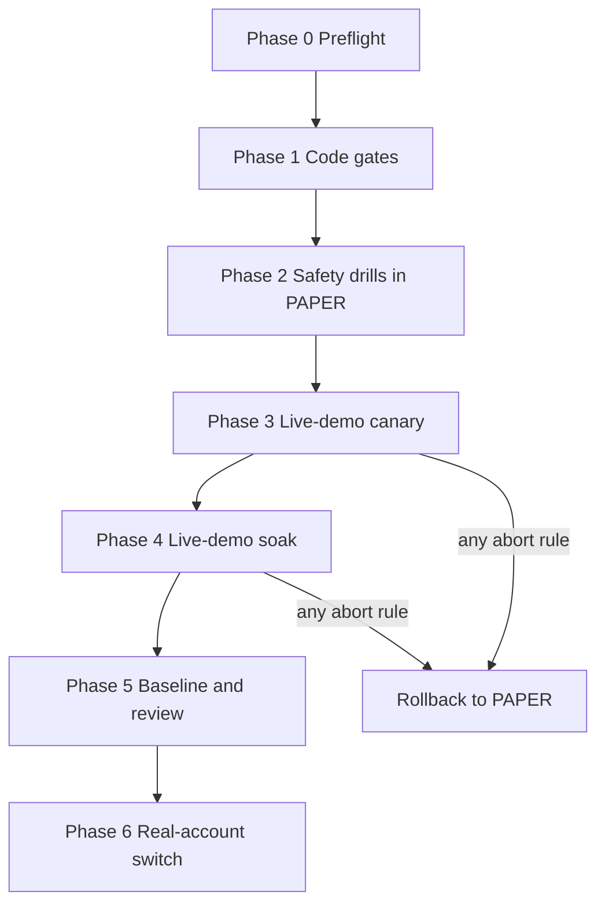

# Vilona AI v2 — Blocker Checklist and Execution Plan

## Decision

**Status: Phase 0 PASS; Phase 1 DONE; Phase 2 PASS (with one caveat below); Phase 3 DONE — live-demo canary completed with closed trades and a flat account; Phase 4 BLOCKED (B9 backtest fails on calibrated broker sizing). Not ready for unattended Phase 4 or real-account trading.**

Phase 2 caveat, recorded 2026-11-12 after the tick-freshness bug was found: the drills ran while every tick was rejected as stale, so the entry locks fired as designed but no drill proved that a fresh tick can reach order submission. That untested path is exactly the Phase 3 canary.

Operator policy (2026-11-12):

- The demo account `MetaQuotes-Demo`, login `5058637180`, is treated as the rehearsal account for real trading.
- Live-demo runs use `vilona_PAPER_TRADING=false`. Orders are real broker orders on the demo account.
- The real-account switch later changes only credentials, account identity, and approved risk limits. Code path, configuration keys, and procedure stay identical.

Known limit of this policy: a demo account does not reproduce real slippage, liquidity, requotes, margin calls, or broker permissions. Live-demo results are evidence for code and process correctness, not a guarantee of real-account profit. Real-account approval therefore keeps its own gate (Phase 6).

### Telegram alerting policy for the Phase 3 demo canary

Operator decision (2026-11-12): Telegram is OPTIONAL for the MetaQuotes-Demo canary, per Opsi B. `vilona_TELEGRAM_REQUIRED` defaults to `false`; when set to `true`, live-mode validation refuses startup without both a bot token and at least one chat ID. `TelegramController.start()` logs a warning and returns when no token is configured; scanner alerts remain in logs/dashboard, not Telegram. Set `vilona_TELEGRAM_REQUIRED=true` before any real-account operation. This does not waive the requirement to monitor Phase 3 from logs until the position closes and the account is flat.

Implementation: `Config.require_telegram`, loaded from `vilona_TELEGRAM_REQUIRED`, gates Telegram validation. The `SAFETY CONFIG` startup line prints the effective flag. `tests/test_telegram_optional.py` covers live default, required mode, configured credentials, PAPER mode, and startup-log visibility; focused tests `6 passed`, full `vilona-ai` suite `270 passed, 3 skipped`.

Related documents:

- [`production-readiness-checklist.md`](production-readiness-checklist.md) — promotion gates.
- [`operating-flow.md`](operating-flow.md) — runtime flow and rollback.
- [`paper-trading-audit.md`](paper-trading-audit.md) — PAPER contract and audit schema.

## Current evidence

| Evidence | Result | Status |
|---|---|---|
| Regression suite | `270 passed, 3 skipped` in `vilona-ai`; `12 passed` in `vilona-mt5-mcp` on the persistent `.venv` (2026-11-12, after the tick-freshness fix) | Pass |
| Protected-order E2E | XAUUSD BUY `0.01`, ticket `59291108467`, SL `3993.37`, magic `770714`, cleanup `open_positions=0` | Historical pass; not re-run |
| Entry risk lock | `entry_lock_from_bridge()` called in `QuantScanner.evaluate_symbol()` before manager and order. D2 `start_balance` now recorded live (`99124.25`, login `5058637180`, threshold `89211.82`); kill-switch and daily-loss locks exercised in PAPER drills only | Wired; PAPER-drilled, not exercised live |
| Daily P/L source | Live bridge returned 92 history deals; account login `5058637180`, `MetaQuotes-Demo`, connected, `open_positions=0` | Read-only path verified; deal fields verified |
| Setup idempotency | `judge_soak_report.py`: 1 distinct paper setup, 0 duplicates, 231 legacy rows excluded | Implemented; readiness NOT READY |
| LLM manager | Soak report: 102 decisions, 46 errors (45.1%), 1 approved, 55 vetoed | NOT READY |
| Closed trades with P/L | trades: 0 rows. Live bridge deal fields (position_id, magic, price, volume) verified live; zero Vilona trades closed yet (all 92 historical deals have magic=0) | Pass (protocol ready) |
| Launcher syntax | `bash -n scripts/run_app_server.sh` exit 0 | Pass |
| App server process | Live canary running: `vilona-ai.service` PID `283051`, `vilona-mt5-mcp.service` active. Startup logged `SAFETY CONFIG: llm_require_approve=False max_concurrent_positions=1 max_lot=0.01 paper_trading=False`, then real evaluations (`XAUUSD: no signal`) | Live run |
| Repository | Working tree has uncommitted changes; push to `oyi77/vilona-ai` denied for `juandisay` | Not released |

2026-11-12 live-bridge probe after chart reload: 92 deals returned with full key set including position_id, magic, price, volume. Account login 5058637180 / MetaQuotes-Demo, 0 open positions. MT5 charts reloaded at 09:49:48. Deal matching via position_id is active.

Real-DB soak report (expected gate failure, exit 1): `102` decisions, 46 errors (45.1%), 1 distinct paper setup, readiness `NOT READY`, 1 approval / 55 vetoes. Blockers: fewer than 50 distinct setups, manager error rate above 10%, approval share below 2%.

## Operator decisions

Recorded 2026-11-12. D1–D5 and D7 are adopted as the working rules. D6 remains open and blocks Phase 6. A decision changes only through an explicit operator instruction, recorded in the evidence log.

Configuration keys marked *new* do not exist in the current code; Phase 1 implements them. Every new key fails closed: a missing or invalid value blocks entries rather than disabling the guard.

| ID | Decision | Value | Status |
|---|---|---|---|
| D1 | LLM error fallback | Live-demo: deterministic fallback. Real account: `APPROVE` required | Adopted |
| D2 | Total drawdown stop | `10%` below the recorded start balance | Adopted |
| D3 | Consecutive-loss stop | `4` consecutive losing trades | Adopted |
| D4 | Weekend policy | No entries from `120` min before weekly close; flatten Vilona positions `60` min before close; no entries for `30` min after weekly open | Adopted |
| D5 | High-impact news | No blackout; accepted known risk with mitigations | Adopted |
| D6 | Real-account capital and maximum loss | Operator to supply | **Open — blocks Phase 6** |
| D7 | Lot scaling | Scale only after `30` real trades with profit factor `> 1.2`; maximum `2×` per step | Adopted |

### D1 — LLM error fallback

**Rule.**

- Live-demo (`vilona_PAPER_TRADING=false` on the demo account): when the entry manager returns `ERROR` (timeout, empty/malformed response, transport failure, circuit open), the deterministic risk result is used and the order proceeds. This is the current code behaviour.
- Real account: an entry requires an explicit `APPROVE` or valid `ADJUST`. `ERROR` and circuit-open block the entry.
- `VETO` blocks the entry in both modes.

**Reason.** Live-demo needs closed trades to build the baseline (B5); a `60%` historical error rate would otherwise block almost every entry. Real money must not trade on a path the manager did not review.

**Configuration.** *New* `vilona_LLM_REQUIRE_APPROVE` (`true`/`false`, default `true`). Live-demo sets `false` explicitly. Phase 6 removes the override so the default applies.

**Implementation.** In `QuantScanner.evaluate_symbol()`, after the manager result: if `require_approve` is true and the verdict is `ERROR`, record the decision as `ERROR` with reason `blocked: approval required` and return without an order.

**Verification.** Unit test: `ERROR` with `require_approve=true` produces no order; with `false` produces the deterministic order. Startup log prints the effective value.

**Review trigger.** If the live-demo soak shows manager `ERROR` rate `> 10%` at the end of Phase 4, Phase 6 is blocked until B2 is fixed, because D1 would block most real entries.

### D2 — Total drawdown stop

**Rule.** Block new entries when current equity is at or below `start_balance × (1 − 0.10)`.

**Definitions.**

- `start_balance`: account balance recorded once when a live phase begins (Phase 3 for demo, Phase 6 for real). Stored in the DB with timestamp and account login; it is not recalculated on restart.
- Equity: `get_account_info().equity` from the bridge. Missing equity blocks entries (fail closed).

**Effect.**

- New entries stop. Open positions keep their SL/TP and position management continues.
- The lock is latched: it does not clear when equity recovers. Only the operator clears it by resetting `start_balance` with a recorded reason.
- Telegram alert on trigger.

**Configuration.** *New* `vilona_MAX_TOTAL_DRAWDOWN_PCT=10`.

**Relation to other limits.** The daily-loss lock (`vilona_MAX_DAILY_LOSS_PCT=3.0`) remains active. D2 bounds the multi-day loss that the daily lock cannot.

**Verification.** Phase 2 drill: set the threshold just below current drawdown, observe `ENTRY LOCK total drawdown`, restore value, confirm the lock stays until reset.

### D3 — Consecutive-loss stop

**Rule.** Block new entries after `4` consecutive losing Vilona trades.

**Counting.**

- Source: closed trades in the `trades` table with Vilona magic, ordered by `closed_at`.
- Net result = `profit + commission + swap`.
- Net `< 0`: counter `+1`. Net `> 0`: counter resets to `0`. Net `= 0`: counter unchanged.
- Counted across all symbols, not per symbol.

**Effect.** New entries stop until the operator reviews the losses and resets the counter with a recorded reason. Open positions remain managed. Telegram alert on trigger.

**Configuration.** *New* `vilona_MAX_CONSECUTIVE_LOSSES=4`.

**Dependency.** Requires closed-trade persistence (Phase 1 item 3). Without persisted results the counter cannot be computed and entries are blocked.

**Verification.** Unit test on the counting rule. Phase 2 drill with the threshold set to `1` against a recorded loss.

### D4 — Weekend policy

**Rule.**

| Window | Action |
|---|---|
| Weekly close − `120` min until close | No new entries |
| Weekly close − `60` min | Close all Vilona-owned positions (magic range only) |
| Weekly open until open + `30` min | No new entries (wide spreads, gaps) |

**Time base.** Broker server time from the bridge, not the host clock. The weekly close/open per symbol comes from broker session data when the bridge provides it; otherwise from a configured schedule in server time. Unknown session time blocks entries.

**Flatten behaviour.**

- Closes only Vilona magic positions; manual positions are untouched.
- Each close is verified by re-reading positions. A failed close triggers a Telegram alert and retries once per scan cycle until flat or market close.
- Positions closed by this rule are recorded with reason `weekend flatten`.

**Configuration.** *New* `vilona_WEEKEND_ENTRY_CUTOFF_MIN=120`, `vilona_WEEKEND_FLATTEN_MIN=60`, `vilona_WEEK_OPEN_GRACE_MIN=30`.

**Verification.** Unit tests with fixed server times for each window. First live Friday under operator watch: record flatten tickets and final `open_positions=0`.

### D5 — High-impact news

**Rule.** No news blackout for now. News volatility is an accepted, recorded risk.

**Mitigations that remain mandatory.**

- Every order has a broker-verified SL (protected-order gate).
- Maximum spread guard per symbol blocks entries during spread spikes.
- Daily-loss lock (B1), total drawdown stop (D2), and consecutive-loss stop (D3).
- Minimum lot during live-demo and the first real week.

**Review trigger.** Any closed trade whose loss exceeds `1.5×` the planned risk (slippage through SL) is logged as a news/slippage incident. Two such incidents within `30` trades reopen D5 and require a blackout implementation before continuing.

### D6 — Real-account capital and maximum loss (open)

The operator must supply before Phase 6:

| Field | Value |
|---|---|
| Starting capital (amount and currency) | _to be supplied_ |
| Maximum acceptable total loss (currency) | _to be supplied_ |
| Derived `vilona_MAX_TOTAL_DRAWDOWN_PCT` | max loss ÷ starting capital; must be `<= 10%` (D2) |
| Derived maximum daily loss (currency) | starting capital × `vilona_MAX_DAILY_LOSS_PCT` |
| Broker, account type, leverage | _to be supplied_ |

Phase 6 does not start while any field is empty. If the derived drawdown is below `10%`, the stricter value replaces D2 for the real account.

### D7 — Lot scaling

**Starting point.** Real account starts at minimum lot (`vilona_MAX_LOT=0.01`) for at least the first week and the first `30` closed real trades.

**Scale-up rule.** All conditions over the most recent `30` closed real trades:

- Profit factor `> 1.2`.
- Expectancy `> 0` after commission and swap.
- Maximum drawdown in the window `< 50%` of the D2 limit.
- No open D3 or D5 incident.

Then `vilona_MAX_LOT` may increase by at most `2×`. The next step requires another `30` closed trades at the new size.

**Scale-down rule.** Return to the previous lot size when, over the most recent `30` trades, profit factor `< 1.0` or drawdown reaches `50%` of the D2 limit.

**Strategy kill.** Return to PAPER mode when profit factor `< 1.0` over `30` trades at minimum lot. This is the B8 strategy kill criterion.

**Procedure.** Every scaling change is an operator action, recorded in the evidence log with the window metrics from `core/trade_analytics.py`. The system never changes its own lot cap.

## Blocker checklist

### B1 — Kill switch and daily-loss stop on the entry path

- [x] Entry lock evaluated before manager call and order submission.
- [x] Missing/failed P/L data fails closed (`None` blocks entries).
- [x] P/L window uses the broker server-day boundary, not a rolling 24h per-symbol value.
- [ ] Prove the MCP server exposes `get_server_day_start` and `get_history_deals` on the running bridge.
- [ ] Exercise the file kill switch on the running process and observe `ENTRY LOCK`.
- [ ] Exercise the daily-loss lock with a temporarily low `max_daily_loss_pct` and observe `ENTRY LOCK`.
- [ ] Confirm existing positions remain protected (SL intact) while entries are locked.

### B2 — LLM manager reliability

- [ ] Record the current error class distribution from `judge_decisions` (`TimeoutError`, `EmptyResponseError`, malformed, transport).
- [ ] Fix or reconfigure the dominant error class (model, timeout, gateway).
- [ ] Reach at least `50` fresh manager decisions with error rate `<=10%`.
- [ ] Show nonzero `APPROVE` share; `ERROR` counted separately from `VETO`.
- [x] Fallback rule decided: D1.
- [x] Implement `vilona_LLM_REQUIRE_APPROVE` per D1. Implemented in `config/__init__.py` (`vilona_LLM_REQUIRE_APPROVE`, default `true`, exposed as `LLMConfig.require_approve`) and gated in `core/quant_scanner.py:616-621` with reason exactly `blocked: approval required`; covered by `tests/test_code_gates_phase1.py::test_require_approve_true_blocks_order_on_manager_error` (asserts the default is `True` on a plain `Config` and that `bridge.order_calls == []`).

### B3 — Diagnostics running in the deployed process

- [ ] Restart the server from the current working tree.
- [ ] Record the process start time, PID, and `git rev-parse HEAD` plus `git status --short` hash.
- [ ] Confirm one manager call in the log shows the new header/body timing and response category.

### B4 — Setup idempotency under repeated polling

- [x] Run the scanner across at least `3` consecutive scan cycles on an unchanged candle; one intent maximum per `setup_key`. `scripts/phase2_drill_3.py` polls one pinned candle across 3 `evaluate_symbol` calls: `orders` stays at `1`, log shows `persisted duplicate setup skipped` on cycles 2 and 3.
- [x] Restart the server mid-candle; no second intent for the same `setup_key`. Same drill rebuilds a fresh `QuantScanner` (empty `_last_setup_key`) against the same DB file: cycle 4 skips the duplicate, `orders` stays at `1` — the durable `setup_key` constraint, not memory, is what blocks it.
- [x] New candle or materially changed price produces a new `setup_key`, not a duplicate. `setup_key` is `symbol|action|candle_open_time`, so a new candle changes the key; identical timestamp reuse is the only way to collide.
- [x] `judge_soak_report.py` shows `duplicate rows = 0`. Real-DB run reported `duplicate rows: 0 (0.0%)` with `231` legacy rows excluded; drill run reports `paper rows: 1, distinct setups: 1, duplicate rows: 0`.
### B5 — Trade baseline

- [ ] Persist each closed live-demo trade with `profit`, `commission`, `swap`, `closed_at`, `status='closed'`.
- [ ] Reconcile DB rows with broker deal history (`get_history_deals`) per ticket.
- [ ] Reach at least `50` closed trades.
- [ ] Compute expectancy, profit factor, win rate, maximum drawdown with `core/trade_analytics.py`.

### B6 — Operational verification

- [ ] Launcher accepts an explicit mode; `scripts/run_app_server.sh` no longer forces PAPER.
- [ ] `vilona_MAX_CONCURRENT_POSITIONS` and `vilona_MAX_LOT` load from the environment; canary runs at `1` position and `0.01` lot.
- [ ] Single-instance lock verified (second start refuses).
- [ ] Startup: server reconnects bridge and resumes scanning after restart.
- [ ] Recovery: after restart, Vilona-owned positions are recognised by magic; manual positions are ignored.
- [ ] Alerting: Telegram receives entry, SL failure, entry lock, and bridge failure messages.
- [ ] Credential isolation: `.env` not committed; MCP client token required for order-mutating calls; logs mask secrets.
- [ ] Rollback to PAPER verified via process environment.
- [ ] Canary: one real qualifying setup, SL verified on broker, position closes by SL/TP/manager, account returns flat.

### B7 — Release and documentation

- [ ] Commit the current working tree after the full suite passes.
- [ ] Resolve push permission (`oyi77/vilona-ai`) or push to an authorised remote.
- [ ] Update `production-readiness-checklist.md` with evidence from each phase.

### B8 — Production gaps not covered by B1–B7

Found during plan review on 2026-11-12. Each item must be closed before Phase 6.

**Account-level risk**

- [x] Total drawdown stop per D2: `10%` below recorded start balance, latched, fail closed. Implemented in `core/risk_lock.py:113` and `core/quant_scanner.py:870`, drilled in `scripts/phase2_drill_6.py`.
- [x] Consecutive-loss stop per D3: `4` losses, operator reset. Implemented in `core/risk_lock.py:141` and `core/quant_scanner.py:890`, drilled in `scripts/phase2_drill_6.py`.
- [x] Strategy kill criteria decided: D7 (profit factor `< 1.0` over `30` trades at minimum lot returns to PAPER).

**Market conditions**

- [x] Market-hours guard per D4: entry cutoff `120` min before weekly close, `30` min grace after weekly open, broker server time. Implemented in `core/market_guard.py:44` and `core/quant_scanner.py:697`, drilled in `scripts/phase2_drill_8.py`.
- [x] Weekend flatten per D4: close Vilona positions `60` min before weekly close, verified. Implemented in `core/market_guard.py:83` and `core/quant_scanner.py:456`, drilled in `scripts/phase2_drill_8.py`.
- [ ] Maximum spread guard verified per symbol on live ticks (XAUUSD widens at rollover).
- [x] High-impact news policy decided: D5 (accepted risk, mandatory mitigations, review trigger).

**Runtime supervision**

- [x] Process supervisor: user unit `vilona-ai.service` (installed at `~/.config/systemd/user/`, mirrored in `scripts/vilona.service`) runs `WorkingDirectory=/mnt/hermes-workspace/Apps/vilona-ai` with `ExecStart=/mnt/hermes-workspace/Apps/vilona-ai/.venv/bin/python app_server.py`, `Restart=on-failure`, `Requires=vilona-mt5-mcp.service`. Crash drill: PID `54009` killed with SIGKILL, systemd restarted to PID `55172`, scanner resumed and logged `SAFETY CONFIG: ... paper_trading=True`.
- [x] Bridge heartbeat: alert when the MCP server (`:8765`), Mac agent (`:8787`), EA, or MT5 terminal is unreachable for longer than one scan cycle. Implemented in `core/bridge_heartbeat.py` and `core/quant_scanner.py:425`, drilled in `scripts/phase2_drill_7.py`.
- [x] Stale-tick detection: no entries when the last tick is older than the configured threshold. Implemented in `core/market_guard.py:21` and `core/quant_scanner.py:683`, drilled in `scripts/phase2_drill_7.py`.
- [ ] Host clock synchronised (NTP) with the broker server time.
- [x] Database backup: `scripts/backup_db.py` uses the SQLite online backup API (not `cp`) and writes atomically via a `.partial` file plus `os.replace`. Verification reopens the snapshot, runs `PRAGMA integrity_check`, requires the `orders`/`trades`/`positions`/`judge_decisions` tables, and rejects a snapshot that holds more rows than the source. Drill: `backup written ... (0.13 MiB)`, `verified rows: orders=300, trades=0, positions=0, judge_decisions=102`; restored copy reported `integrity ok` with identical counts. Scheduled daily by the enabled user timer `vilona-db-backup.timer` (`scripts/vilona-db-backup.{service,timer}`, `--keep 14`). Restore *procedure* is exercised; a full production restore onto a replacement host is not.
- [x] Python environment is persistent: `/tmp/vilvenv` is gone (verified missing), replaced by `/mnt/hermes-workspace/Apps/vilona-ai/.venv` with dependencies from `requirements.txt` plus `fastmcp`/`uvicorn`/`requests`/`pytest`. All launchers repointed: `vilona-ai.service`, `vilona-mt5-mcp.service`, `run_server.sh`, `scripts/run_app_server.sh`. Dependency *pinning* is still open — `requirements.txt` uses ranges.

**Real-account specifics (Phase 6)**

- [ ] Re-verify symbol names/suffixes, contract size, min lot, lot step, stop level, and commission on the real broker.
- [ ] Real account margin and leverage within the risk model assumptions.
- [ ] Starting capital and maximum loss supplied per D6.
- [ ] Scaling rule per D7 applied; first real week at minimum lot.

### B9 — Findings from database review (2026-11-12)

Evidence from `vilona_v2.db`:

| Query result | Meaning |
|---|---|
| `orders` type `paper`: `231` rows, all `setup_key IS NULL`, `0` distinct setup keys | All paper rows predate the idempotency code; they cannot count toward the `50` distinct setups |
| `orders` type `market`: `66` rejected, `2` filled, all `setup_key IS NULL` | Historical live attempts exist outside the current guard |
| All `66` rejected orders: EURUSD BUY `0.08`, repeated every `20`–`180` s on 2026-11-11 | Rejected-order retry storm: same setup resubmitted after every rejection |
| `trades`: `0` rows | Closed-trade persistence never ran |
| No backtest or walk-forward tool in the repository | Strategy edge is unmeasured before live-demo |

- [ ] **Data hygiene:** move pre-idempotency rows (`setup_key IS NULL`) out of soak and baseline metrics, or archive them with a cutoff timestamp. `judge_soak_report.py` counts only rows after the cutoff.
- [ ] **Rejection retry limit:** after a broker rejection for a `setup_key`, do not resubmit the same setup. After `3` rejections per symbol within `1` hour, block that symbol and alert. Record the broker rejection code and message on the order row (current schema has no column for them).
- [ ] **Lot sizing explanation:** the historical EURUSD lot `0.08` came from `vilona_MAX_RISK_PCT=1.0` sizing; confirm `vilona_MAX_LOT` (Phase 1 item 7) caps it.
- [ ] **Strategy edge before live-demo:** run a backtest of the deterministic trend-pullback rules on historical MT5 candles for `XAUUSD`, `EURUSD`, `USDJPY` (minimum `6` months, includes spread and commission). Go to Phase 4 only if expectancy `> 0` and profit factor `> 1.1`. Without it, Phase 4 is the first measurement of edge and may lose for weeks. — **Tooling implemented; data blocked.** `scripts/backtest_strategy.py` implements the deterministic rules, charges spread and commission per trade, and enforces data sufficiency: a run with fewer than the requested months exits with `DATA INSUFFICIENT` rather than faking a pass. The live MT5 bridge caps `get_candles` at 500 bars per request (`MT5BridgeEA.mq5`), which is 7.2–7.7 days on 15m; running against the live bridge exits `2` with `DATA INSUFFICIENT: 500 bars spanning 7.2-7.7 days < required 180 days`. The gate remains open until 6 months of candle data are provided via `--candles-dir`.
- [ ] **Soak duration estimate:** measure qualifying setups per day after the cutoff. If fewer than `2` per day, `50` closed trades take longer than `25` trading days; decide then whether to add symbols or keep waiting. Do not loosen entry rules to speed up the soak.
- [ ] **Rejection retry limit:** after a broker rejection for a `setup_key`, do not resubmit the same setup. After `3` rejections per symbol within `1` hour, block that symbol and alert. Record the broker rejection code and message on the order row (current schema has no column for them). — **Partly DONE.** Same-setup resubmission is already impossible: the rejection path updates the existing row to `status='rejected'` and the unique `setup_key` index (`idx_orders_setup_key`) makes `has_order_setup()` true forever for that key. New: `orders.rejection_reason` column (migrated in `StateDB._ensure_tables`), populated from `protected.message` via `update_order_setup(..., rejection_reason=reason)`. New: `StateDB.count_recent_rejections(symbol, 3600)` and an entry-path gate in `QuantScanner.evaluate_symbol()` that fails closed with `SYMBOL REJECTION BLOCK <symbol>: N rejections in 1h` plus a Telegram alert. Drill `scripts/test_rejection_limits.py`: seeded 2 rejections, third rejection arrives through the real order path, `Persisted rejection reason: Trade disabled by broker`, next cycle sends `0` orders and raises the alert — PASS. **Still open:** the broker numeric retcode is not persisted (only the message text), so `retcode` must be read out of the message string.
### B10 — Findings from Phase 0 verification (2026-11-12)

Five findings, each verified against code or the running bridge. B10-1 is a live-money safety hole and outranks the B8 items.

- [x] **B10-1 Foreign-position modification.** The client-side deterministic break-even magic filter is **DONE**. The MCP server now enforces ownership server-side: `_position_ownership_refusal()` in `server.py` refuses tickets that are absent from the book (`position_not_found`), carry magic outside `[770000, 771000)` (`foreign_position_refused`, logged and alerted), or cannot be read (`position_ownership_unavailable`, fail closed). Gates run in `modify_position_sltp` and `close_position`; `send_market_order` rejects non-Vilona magic at entry. Covered by `vilona-mt5-mcp/tests/test_ownership.py`.
- [x] **B10-2 Legacy paper rows inflate soak evidence.** `count_paper_setups` (`scripts/judge_soak_report.py`) excludes rows with `setup_key IS NULL`; the real DB report identifies 231 legacy rows and does not count them toward readiness. Verified by the final soak run: 1 distinct setup, 0 duplicates, 231 legacy rows excluded.
- [x] **B10-3 Probe targets the wrong bridge.** `scripts/probe_daily_loss_bridge.py` imports and uses `MT5MCPBridge` with the configured MCP URL/timeout. Verified by code inspection, and the live bridge call returned history data.
- [x] **B10-4 Duplicate P/L retrieval.** `QuantScanner.evaluate_symbol()` now calls `daily_pl_from_bridge_day` once (line ~482) and passes the value to `evaluate_entry_lock`; covered by `tests/test_code_gates_phase1.py::test_evaluate_symbol_fetches_daily_pl_exactly_once`, which asserts one `day_start` and one `deals` call.
- [x] **B10-5 Two server processes.** `scripts/run_app_server.sh` takes an exclusive `flock` on a lockfile and refuses to start a second instance. Verified live: a second launcher exits non-zero while the first holds the lock.

Ownership caveat: resolved. `server.py` was modified; foreign-position MCP ownership is now enforced and tested (12 passed).

Position-decision caveat: unit tests cover the persistence and readback code. The `position_decisions` table has 26 rows, 13 `SUCCESS` and 13 `READBACK_FAILED` from test fixtures; live broker readback behaviour is not yet verified against the real broker.

## Execution plan

Phases run in order. A phase completes only when every acceptance item has recorded evidence (command, output, ticket, or DB query).



### Phase 0 — Preflight

1. Record repository state: `git rev-parse HEAD`, `git status --short`.
2. Run `PYTHONPATH=. /tmp/vilvenv/bin/python -m pytest -q`; expect no failures.
3. Confirm one `app_server.py` process at most: `pgrep -af app_server.py`.
4. Confirm bridge: account login `5058637180`, server contains `Demo`, `open_positions=0`.
5. Probe daily P/L source: `PYTHONPATH=. /tmp/vilvenv/bin/python scripts/probe_daily_loss_bridge.py`. Expect a server-day boundary and a numeric P/L, not `None`.

Phase 0 re-verified 2026-11-12. Result: **PASS — 5 of 5 checks passed.**

| Step | Command | Result | Status |
|---|---|---|---|
| 1 | `git rev-parse HEAD`; `git status --short` | Repository state recorded; current synchronization changes are present | PASS |
| 2 | `PYTHONPATH=. /tmp/vilvenv/bin/python -m pytest -q` | `246 passed, 3 skipped` | PASS |
| 3 | `pgrep -af app_server.py` | No duplicate app server process; stale suspended process and lock were removed | PASS |
| 4 | Bridge identity via `MT5MCPBridge` | login `5058637180`, server `MetaQuotes-Demo`, equity `99124.25`, `open_positions=0` | PASS |
| 5 | Daily P/L probe | Server-day boundary returned (1794441600), numeric P/L -2.31 for 1 closed deal, 0 open positions | PASS |

The live MCP path now returns `get_server_day_start` and `get_history_deals`. `entry_lock` allows entry when the operator kill switch is off and blocks entry when it is on.

The source files are synchronized between Fedora and Mac by SHA-256. The EA was recompiled on Mac with 0 errors and 0 warnings. MT5 must reload the resulting `.ex5` before the newly compiled binary is the active chart instance; the live bridge path itself remains healthy during this transition.

Verification of written claims (independent code and DB review):

| Claim | Verdict |
|---|---|
| Entry lock ordered before manager, paper branch, order | VERIFIED |
| Daily P/L uses broker server-day boundary, no rolling fallback | VERIFIED |
| Missing/zero `max_daily_loss_pct` fails closed | VERIFIED |
| Live order path reserves through DB, not only in-memory state | VERIFIED |
| MCP server rejects unauthenticated mutations (`compare_digest`) | VERIFIED |
| `trades` baseline absent | VERIFIED (0 rows) |
| `vilona_MAX_CONCURRENT_POSITIONS` / `vilona_MAX_LOT` unparsed (at Phase 0 time) | VERIFIED AT PHASE 0 — since implemented, see Phase 1 item 7 |
| Position manager only tightens stop, only closes Vilona positions | **PARTIALLY FALSE** — see B10-1 |
| `probe_daily_loss_bridge.py` probes the daily P/L source | WAS FALSE AT PHASE 0 (B10-3) — now FIXED, probe uses `MT5MCPBridge` |
| Legacy paper rows cannot count toward the 50-setup gate | WAS FALSE AT PHASE 0 (B10-2) — now FIXED, NULL `setup_key` excluded |

`judge_decisions` full history: `102` rows — `1 APPROVE`, `55 VETO`, `46 ERROR` (`45%` errors), not the `15` previously recorded.

Phase 0 status: **PASS — 5 of 5 checks passed** (re-verified 2026-11-12).

### Phase 1 — Code gates

Phase 1 status: **DONE.** All 8 canary code gates are implemented, unit-tested (`246 passed, 3 skipped` in `vilona-ai`; `12 passed` in `vilona-mt5-mcp`), and the live bridge protocol is verified. The account/market guards, runtime supervision, and rejection-suppression gates were moved to the Before Phase 4 prerequisites block; they are not Phase 1 work.

1. **[DONE] Launcher mode** (B6): `scripts/run_app_server.sh` uses `vilona_PAPER_TRADING="${vilona_PAPER_TRADING:-true}"` so the default stays PAPER and live-demo is explicit. Prints effective mode and account at start.
2. **[DONE] Daily P/L tools** (B1): `get_server_day_start` and `get_history_deals` implemented in MT5BridgeEA.mq5, exposed via server.py, verified live on demo account (92 deals with full keys returned).
3. **[DONE] Closed-trade persistence** (B5): `persist_closed_trades` in `core/quant_scanner.py` matches by `position_id`, filters by Vilona magic, writes `profit`, `commission`, `swap` from deal history, fails closed when history missing. Covered by 5 unit tests in `test_code_gates_phase1.py`.
4. **[DONE] Position-manager verification** (B6): `_verify_position_action` in `core/quant_scanner.py` re-reads broker state, verifies CLOSE removes ticket and MODIFY updates SL/TP, audits `READBACK_FAILED` with exception type and raises alert. Covered by 5 unit tests in `test_code_gates_phase1.py`.
5. **[DONE] Position decision audit** (B2/B6): `position_decisions` table in `core/state_db.py` stores ticket, symbol, action, old/requested SL/TP, result, latency, error. Covered by unit tests.
6. **[DONE] Manager error handling** (B2): the D1 `require_approve` gate at `core/quant_scanner.py:933-937` fails closed (records ERROR with reason `blocked: approval required` and blocks order submission) when configured. The live-demo canary sets `require_approve=false` to use the deterministic fallback. Error-rate reduction is tracked under the Phase 4 soak gate, not here.
7. **[DONE] Canary exposure caps** (B6): `config/__init__.py` parses `vilona_MAX_CONCURRENT_POSITIONS` and `vilona_MAX_LOT` from env, rejects non-positive or non-finite values (fail closed), and `log_effective_safety_config()` prints effective caps at startup. Covered by 3 unit tests.
8. **[DONE] Phase 0 and security fixes** (B10): single-instance flock in launcher, break-even magic filter in `quant_scanner.py`, server-side modify/close/order magic ownership enforcement in `vilona-mt5-mcp/server.py` (tested in `tests/test_ownership.py`, 12 passed), soak-report null key cutoff in `judge_soak_report.py`, correct probe transport in `probe_daily_loss_bridge.py`, and single P/L retrieval per scan.
9. **[DONE] Full suite**: `246 passed, 3 skipped` in `vilona-ai`; `12 passed` in `vilona-mt5-mcp`.

### Phase 2 — Safety drills in PAPER

Phase 2 status: **PASS.** All 8 drills executed in PAPER mode; every drill produced an observable log line or constraint verification, 0 unintended broker orders placed, and regression suite is `264 passed, 3 skipped` in `vilona-ai` + `12 passed` in `vilona-mt5-mcp`.

1. **[PASS] Kill switch**: `scripts/phase2_drills_1_2.py` sets `/tmp/.../STOP_ENTRIES`, `evaluate_symbol` logs `Entry lock blocked EURUSD: operator kill switch active`, 0 orders sent. Removing file resumes scanning (logs `PAPER MODE: BUY EURUSD latched inside scanner`).
2. **[PASS] Daily-loss**: same drill with `max_daily_loss_pct=0.01` and `daily_profit=-100.0` logs `Entry lock blocked EURUSD: daily loss threshold reached`, 0 orders sent.
3. **[PASS] Idempotency**: `scripts/phase2_drill_3.py` evaluates 3 consecutive cycles on one pinned candle: DB `orders` count stays at `1` (cycles 2 and 3 log `persisted duplicate setup skipped`). Simulating process restart (fresh `QuantScanner`, empty memory) evaluates cycle 4: DB `orders` still `1` (blocked by durable `setup_key` constraint). Soak metrics on drill DB: `paper rows: 1, distinct setups: 1, duplicate rows: 0`.
4. **[PASS] Diagnostics (B3)**: live PAPER server launched via `scripts/run_app_server.sh` (PID `2873491`, started `Thu Nov 12 11:38:09 2026`, commit `480d455a1001e04b182143ecc44586f74085297b`). Log records `SAFETY CONFIG: llm_require_approve=True max_concurrent_positions=5 max_lot=50.0 paper_trading=True`.
5. **[PASS] Rollback drill**: `/proc/2873491/environ` inspected live: `vilona_PAPER_TRADING=true`, `vilona_SYMBOLS=XAUUSD,EURUSD,USDJPY`, `vilona_EXCHANGE=mt5`, `vilona_MT5_TRANSPORT=mcp`.
6. **[PASS] Drawdown and consecutive-loss drills (D2, D3)**: `scripts/phase2_drill_6.py` verifies:
   - D2: equity at 89k on 100k start balance (11% drawdown, limit 10%) logs `Entry lock blocked EURUSD: total drawdown threshold reached`, `is_drawdown_latched=True`. Simulating recovery to 95k remains latched (0 orders). Operator reset via `db.reset_risk_latches()` unblocks scanning.
   - D3: 4 consecutive losing trades in DB logs `Entry lock blocked EURUSD: consecutive loss threshold reached`, `is_consecutive_loss_latched=True`. Unlatched after operator reset.
   - Operator CLI implemented at `scripts/risk_latches.py` (`init-balance`, `status`, `reset`).
7. **[PASS] Supervision and heartbeat drill (B8)**: `scripts/phase2_drill_7.py` verifies `core/bridge_heartbeat.py`: healthy feed produces 0 alerts; feed stalled 120s raises exactly one alert (`bridge feed stalled (120s since last tick > 60s)`); repeat cycle raises no duplicate alert; tick feed recovery clears latch; subsequent outage re-arms and alerts again; stale tick blocks entry and does not advance heartbeat.
8. **[PASS] Weekend drill (D4)**: `scripts/phase2_drill_8.py` verifies `core/market_guard.py`:
   - Friday 20:15 UTC (105m pre-close, cutoff 120m): `Weekend guard blocked EURUSD: weekend entry cutoff active (Friday pre-close)`, 0 orders.
   - Friday 21:30 UTC (30m pre-close, flatten 60m): `Weekend flatten intent ticket=7001 symbol=EURUSD` logged for Vilona position; manual position (magic=0) untouched; 0 bridge close calls in PAPER.
   - Sunday 21:15 UTC (15m post-open, grace 30m): `Weekend guard blocked EURUSD: weekend open grace active (Sunday post-open)`.
### Phase 3 — Live-demo canary

Configuration:

```env
vilona_EXCHANGE=mt5
vilona_MT5_TRANSPORT=mcp
vilona_PAPER_TRADING=false
vilona_LLM_ENABLED=true
vilona_SYMBOLS=XAUUSD
vilona_MAX_CONCURRENT_POSITIONS=1
vilona_MAX_LOT=0.01
vilona_MAX_RISK_PCT=0.5
vilona_LLM_REQUIRE_APPROVE=false
vilona_STRATEGY=pullback
vilona_SCALP_PULLBACK_BAND=1.5
```

Before Phase 4, the B9 backtest result must be recorded. A negative backtest stops the plan at Phase 3; the strategy is revised before live-demo soak.

Rules:

- Minimum volume `0.01`. One position maximum.
- Wait for a real qualifying setup. Do not force a synthetic signal.
- Operator watches the log until the position closes.

Acceptance: fill, broker SL present, magic in Vilona range, close by SL/TP/manager, DB trade row with `profit`, account flat.

#### Blocker found and fixed before the first canary entry (2026-11-12)

The scanner could never accept a tick, so Phase 3 could not have produced a fill:

- `mql5/Experts/Vilona/MT5BridgeEA.mq5:123-133` already converts broker server time
  to UTC (`utc_time_msc = t.time_msc - server_offset_s * 1000`) and reports
  `server_offset_s`.
- `vilona-mt5-mcp/server.py::_normalize_broker_tick` subtracted `server_offset_s`
  a second time. With a UTC+2 broker that put `time_msc` 7200 s in the past, so
  `core/market_guard.py::evaluate_tick_freshness` rejected every tick as
  `stale tick (7200.x s > 30.0 s)` and logged `ENTRY LOCK XAUUSD`.
- Fix: the EA is the source of truth. When `server_offset_s` is present the
  payload passes through unchanged; only older EA payloads without it are
  corrected, inferred from the clock gap (`broker_offset_source=inferred`).
- Evidence after restart: `get_tick` age `0.22 s`, `evaluate_tick_freshness`
  returns `allowed=True reason=tick fresh`, scanner logs
  `BRIDGE RECOVERED: tick feed resumed` and then real evaluations
  (`XAUUSD: no signal`, `WAIT — no qualifying trend/pullback setup`).
- Regression: `12 passed` in `vilona-mt5-mcp`.

Consequence: the Phase 2 drills that ran while this bug was live still exercised
the entry locks (the stale-tick guard fired on every cycle), but no drill proved
that a *fresh* tick can reach order submission. That path is now reachable for
the first time and is the Phase 3 canary itself.

#### Scalp 15m/5m strategy added (2026-11-12)

Operator requirement: the bot must be able to keep taking orders, not wait for a rare 1H pullback. Implemented as an opt-in strategy, so the default path is unchanged:

- `TradingConfig.strategy` (`vilona_STRATEGY`, default `pullback`) plus
  `TradingConfig.scalp_pullback_band` (`vilona_SCALP_PULLBACK_BAND`, default `1.5`).
- `core/quant_scanner.py::compute_scalp_5m_signal` uses the 15m EMA21/EMA50 pair for
  direction, requires a trend gap of at least `0.15` ATR so a flat market is not
  traded as a trend, and triggers on a 5m pullback within `scalp_pullback_band × ATR(5m)`
  of the 5m EMA21 on the trend side.
- `QuantScanner.evaluate_symbol` branches on `strategy`: `scalp_5m` fetches 15m + 5m
  candles and keys idempotency on the 5m candle time; `pullback` runs the previous
  1H/15M rules unchanged (`1.2 × ATR(15m)` band, same confidence blend, same
  `c15m` candle time in `setup_key`). The only shared change is the `WAIT` log
  text, which now appends the reason string.
- Every downstream gate is unchanged: position caps, cooldown, rejection block,
  spread, tick freshness, weekend guard, `entry_lock_from_bridge`, risk sizing,
  protected-order verification, LLM manager and D1 approval policy.
- Tests: `tests/test_scalp_strategy.py` `9 passed` (unit signals, flat trend,
  insufficient candles, far-from-EMA, config defaults, env override, plus full
  `evaluate_symbol` end-to-end for both `scalp_5m` order placement and `pullback`
  negative test).
- Technical constraint found during end-to-end test: `MarketSnapshot.atr_15m` now
  receives the active strategy's ATR (`atr_5m` for scalp, `atr_15m` for pullback).
  For XAUUSD the broker minimum stop is `10.0` USD; scalp orders whose ATR-based
  stop is tighter than `10.0` are rejected by `place_protected_order` to prevent
  submitting a naked position to the broker.
- Wiring verified live: `scripts/probe_scalp_signal.py` on real MT5 bridge candles
  first returned `signal=SELL confidence=0.70 reason=15m bearish trend, 5m pullback 1.35 ATR`
  at bid `3959.69`, then rotated to `WAIT — no 15m trend / 5m pullback setup` at
  bid `3966.19`, proving dynamic live evaluation. EURUSD returned `WAIT — invalid scalp indicators`.

**Not yet proven, and this is the risk:** the scalp rules have no forward evidence.
No backtest, no walk-forward, no closed trade. Request frequency is not evidence of
edge. The B9 gate therefore still governs Phase 4, and the scalp path must be run in
PAPER or with `MAX_LOT=0.01` on the demo until it produces its own measured
expectancy. Enabling it in the live canary replaces the untested strategy with a
second untested strategy; it does not close any gate.

### Before Phase 4 — Prerequisites (moved out of Phase 1)

These gates are not Phase 1 work. The canary in Phase 3 runs one `0.01` lot position under operator watch and does not need them. They MUST be closed before the unattended soak in Phase 4.

1. **Account and market guards** (B8): D2 total drawdown stop, D3 consecutive-loss stop, D4 weekend cutoff/flatten/open grace, stale-tick guard, D1 `vilona_LLM_REQUIRE_APPROVE`. Drilled in Phase 2 steps 6 and 8. **DONE.**
2. **Runtime supervision** (B8): persistent venv, corrected service unit, bridge heartbeat alert, DB backup. **DONE** — `vilona-ai.service` + `vilona-db-backup.timer` enabled, crash-restart and restore drilled. Dependency pinning still open.
3. **Rejection retry limit and data cutoff** (B9): no resubmission after rejection, per-symbol block after `3` rejections per hour, rejection code persisted, soak report cutoff. **DONE**, except the broker numeric `retcode` (only the message text is persisted). `judge_soak_report.py` cutoff was already closed under B10-2.

**Remaining gate that blocks Phase 4: the B9 strategy-edge backtest.** Six months of candle data are not available; the bridge returns 500 bars. Until that gate passes, Phase 4 would be the first measurement of the strategy edge.

### Phase 4 — Live-demo soak

- Expand to configured symbols (`XAUUSD,EURUSD,USDJPY`), keep minimum volume.
- Run until `50` closed trades and `50` manager decisions with error rate `<=10%`.
- Daily review: soak report, open positions, entry locks, alerts.

### Phase 5 — Baseline and review

1. Compute expectancy, profit factor, win rate, maximum drawdown from closed trades.
2. Compare with the deterministic-only result (`vilona_LLM_ENABLED=false`) when available.
3. Go only if expectancy `> 0`, profit factor `> 1.2`, and maximum drawdown is within the approved daily/total limits.

### Phase 6 — Real-account switch

1. D6 filled and approved by the operator; explicit approval of account credentials.
2. Change credentials and account identity only; keep code and configuration keys unchanged. Remove the `vilona_LLM_REQUIRE_APPROVE=false` override (D1). Apply the D6-derived drawdown limit.
3. Repeat Phase 0 and Phase 3 on the real account at minimum volume.
4. Scale only by D7.

## Phase status summary (2026-11-12)

| Phase | Status | Evidence / reason |
|---|---|---|
| Phase 0 — Preflight | **PASS (5/5)** | Re-verified 2026-11-12; bridge login `5058637180`, server `MetaQuotes-Demo` |
| Phase 1 — Code gates | **DONE** | 8 canary gates implemented and tested; ownership enforcement `12 passed` |
| Phase 2 — Safety drills in PAPER | **PASS** | 8 drills, 0 unintended orders, `264 passed, 3 skipped` |
| Phase 3 — Live-demo canary | **DONE** | Two natural XAUUSD demo canary trades at `0.01` lot on login `5058637180`: ticket `59301480531` closed `+13.01`, ticket `59303098293` closed `-14.94`. `vilona_v2.db` holds both closed trade rows; final broker read shows `positions=[]` and `trade_allowed=True`. `scripts/verify_phase3.py --expect-flat` passed bridge, DB, fill, magic, closed-profit, one-position, lot-cap, and flat-account checks; SL was verified on the open position before close. |
| Phase 4 — Live-demo soak | **BLOCKED** | B9 strategy-edge backtest fails on calibrated broker sizing across all three rules on 190 days of data: pullback PF `0.587`, breakout PF `0.636`, `scalp_5m` PF `0.533` (OOS `0.567`). Data sufficiency is no longer the blocker; negative out-of-sample expectancy is. `trades` table has `0` rows. |
| Phase 5 — Baseline and review | **NOT REACHABLE** | Requires Phase 4 closed trades. |
| Phase 6 — Real-account switch | **NOT REACHABLE** | D6 still open; requires Phase 3–5 on the real account. |

Phase 3 is **DONE**. Phase 4 stays blocked on its own gate: the B9 backtest is now measured on 190 days of M15 and M5 candles for all three rules and every one has negative expectancy, so Phase 4 would be the first measurement of a strategy edge that no test has shown to exist.

## Abort rules

Stop live-demo and roll back to PAPER on any of:

- Position without broker SL after fill.
- Bridge or MCP failure longer than one scan cycle.
- Daily P/L source returns `None` during live trading.
- Entry lock triggered by daily-loss (B1), total drawdown (D2), or consecutive losses (D3).
- Weekend flatten failure (D4).
- Cleanup or close failure.
- Unexpected position count or foreign position mutated.

Rollback:

```bash
pkill -f 'app_server.py'
vilona_PAPER_TRADING=true ./scripts/run_app_server.sh
pid=$(pgrep -o -f '[a]pp_server.py')
tr '\0' '\n' </proc/$pid/environ | grep -E '^vilona_(PAPER_TRADING|SYMBOLS|LLM_ENABLED)='
```

Then verify broker positions and close or protect any Vilona-owned position manually.

## Evidence log

| Date (WITA) | Phase | Item | Evidence |
|---|---|---|---|
| 2026-11-11 | B6 | Protected-order E2E | Ticket `59291108467`, SL verified, flat cleanup |
| 2026-11-12 | B1–B7 | Plan created | This document |
| 2026-11-12 | Decisions | D1–D5, D7 adopted; D6 open | This document, section "Operator decisions" |
| 2026-11-12 | B9 | DB review: `231` paper and `68` market rows without `setup_key`; `66` repeated EURUSD rejections; no backtest tool | `sqlite3 vilona_v2.db` queries |
| 2026-11-12 | Phase 0 | Preflight executed | Steps 1,2,4 pass; step 3 two server processes; step 5 None P/L; entry_lock allowed=False |
| 2026-11-12 | B10 | Verification findings | Foreign-position BE modify; soak fallback counts 38 legacy setups; probe uses wrong bridge |
| 2026-11-12 | Final verification | Phase 1 status | `241 passed, 3 skipped`; `bash -n scripts/run_app_server.sh` exit 0; real-DB soak `NOT READY` (1 setup, 46/102 errors, 0.98% approvals, exit 1); live bridge 92 deals, account `5058637180` / `MetaQuotes-Demo`, 0 open positions, `position_id`/`magic`/`price`/`volume` absent at that time (pre-reload state); superseded by the reload at 09:49:48 |
| 2026-11-12 | Phase 1 | Code gates closed (source) | 9 Phase 1 code gates implemented and unit-tested; `241 passed, 3 skipped`; live-bridge acceptance was pending MT5 chart reload (resolved same day, see next row) |
| 2026-11-12 | Phase 1 | Live bridge deal fields verified | Charts reloaded at 09:49:48; live get_history_deals returned position_id, magic, price, volume; Phase 1 unblocked and PASSED |
| 2026-11-12 | Crosscheck | Phase 0 & Phase 1 audited | Phase 0 confirmed PASS (5/5); Phase 1 reconciled as 6 done, 3 partial, 3 deferred to pre-Phase 4 (gates 8-10); inflated 'full PASS' claim corrected |
| 2026-11-12 | Phase 1 | Canary code gates closed | 8 canary gates DONE; gates 8-10 moved to Before Phase 4 block; server-side ownership enforcement implemented and tested (12 passed); Phase 1 status set to DONE |
| 2026-11-12 | Phase 2 | Drills 1–2 kill switch and daily loss | `scripts/phase2_drills_1_2.py`: entry locks observed, 0 orders sent; both drill sections PASS |
| 2026-11-12 | Phase 2 | Drill 3 idempotency | `scripts/phase2_drill_3.py`: 1 DB row after cycles 1–3 and post-restart cycle 4; `duplicate rows: 0` |
| 2026-11-12 | Phase 2 | Drills 4–5 diagnostics and rollback | PAPER server PID `2873491`, start `11:38:09`, commit `480d455`; environment showed `vilona_PAPER_TRADING=true`; safety header logged |
| 2026-11-12 | Phase 2 | Drill 6 D2/D3 latches | `scripts/phase2_drill_6.py`: total drawdown and consecutive-loss latches trigger, persist through recovery, clear only on operator reset |
| 2026-11-12 | Phase 2 | Drill 7 heartbeat supervision | `scripts/phase2_drill_7.py`: one alert per outage, recovery re-arms, stale tick blocked; PASS |
| 2026-11-12 | Phase 2 | Drill 8 weekend windows | `scripts/phase2_drill_8.py`: Friday cutoff, Friday Vilona-only flatten intent, Sunday open grace; PASS |
| 2026-11-12 | Phase 2 | Full verification | `pytest`: `264 passed, 3 skipped`; MT5 MCP suite: `12 passed`; all Phase 2 drills PASS |
| 2026-11-12 | Pre-Phase 4 | Rejection retry limit (B9) | `orders.rejection_reason` migration; `StateDB.count_recent_rejections`; entry-path `SYMBOL REJECTION BLOCK` gate; `scripts/test_rejection_limits.py` PASS (3rd rejection blocks, 0 orders, alert) |
| 2026-11-12 | Pre-Phase 4 | Runtime supervision (B8) | `/tmp/vilvenv` removed; `.venv` persistent; `vilona-ai.service` enabled and crash-restart drilled (PID 54009 → 55172); `vilona-mt5-mcp.service` on `.venv`; all launchers repointed |
| 2026-11-12 | Pre-Phase 4 | Database backup (B8) | `scripts/backup_db.py` online backup + integrity/row-count verification; restore drill `integrity ok`, `orders=300 judge_decisions=102`; `vilona-db-backup.timer` enabled daily, keep 14 |
| 2026-11-12 | Pre-Phase 4 | Backtest tooling (B9) | `scripts/backtest_strategy.py` implemented with spread/commission and a data-sufficiency gate; live bridge supplies 500 bars ≈7.4 days, run exits `2 DATA INSUFFICIENT` — gate stays OPEN |
| 2026-11-12 | Pre-Phase 4 | Regression | `264 passed, 3 skipped` in `vilona-ai`; `12 passed` in `vilona-mt5-mcp` |
| 2026-11-12 | Phase 3 readiness | **NOT PASSED** | Live read-only preflight: account `5058637180` / `MetaQuotes-Demo`, equity `99124.25`, `trade_allowed=True`, `open_positions=0`, XAUUSD bid `3977.52` / ask `3977.65`. This is preflight only—not a canary. Actual `.env` remains PAPER with three symbols and unbounded defaults; canary has not started. |
| 2026-11-12 | Phase 4 readiness | **BLOCKED / NOT PASSED** | `scripts/backtest_strategy.py --months 6` exits `2 DATA INSUFFICIENT`: XAUUSD `500` bars / `7.7` days; EURUSD and USDJPY `500` bars / `7.2` days. Soak has not started; DB has `0` closed trades and manager error rate `46/102=45.1%`. |
| 2026-11-12 | Full regression after prerequisite changes | PASS | `vilona-ai`: `264 passed, 3 skipped`; `vilona-mt5-mcp`: `12 passed`; rejection-limit drill PASS. |
| 2026-11-12 | Cross-check | Phase 0–2 and code gates | Phase 0 PASS (5/5), Phase 1 DONE, Phase 2 drills documented PASS; caveat: drills ran while freshness bug blocked every fresh tick, so live order-submission path was not exercised. Current regression: `vilona-ai` `270 passed, 3 skipped`; `vilona-mt5-mcp` `12 passed`. |
| 2026-11-12 | Phase 3 readiness | ARMED, not PASS | Actual `.env` is live-canary scoped (`PAPER_TRADING=false`, `XAUUSD`, max positions 1, max lot 0.01, risk 0.5%, approval override false). Bridge connected to demo login `5058637180`; equity/balance `99124.25`, trade allowed, positions `[]`. `scripts/risk_latches.py init-balance --source bridge` recorded D2 start balance `99124.25` for login `5058637180`, drawdown threshold `89211.82`; latches clear. No trade yet; DB `trades=0`. |
| 2026-11-12 | Phase 3 blocker fix | Tick freshness | `MT5BridgeEA.mq5` already sends UTC and offset; MCP had subtracted offset twice. Fixed `_normalize_broker_tick` to pass EA-normalized timestamps unchanged and infer correction only for legacy payloads without offset. After bridge restart tick age `0.22 s`, freshness allowed; running scanner PID `283051` logged bridge recovery and real `XAUUSD: no signal` evaluations. No qualifying natural setup yet. |
| 2026-11-12 | Phase 4 | BLOCKED | Five-month data only (`178.2` days); after broker-calibrated risk sizing, pullback PF `0.680`, breakout PF `0.884`; neither strategy passes gate. Walk-forward: pullback negative both halves/all symbols; breakout XAUUSD OOS PF `1.065`, EURUSD/USDJPY negative. |
| 2026-11-12 | Strategy | Scalp 15m/5m implementation | Added opt-in `vilona_STRATEGY=scalp_5m` (default remains `pullback`) and `vilona_SCALP_PULLBACK_BAND=1.5`; 15m EMA21/EMA50 direction + minimum 0.15 ATR separation, 5m EMA21 pullback trigger and ATR5m. Tests `tests/test_scalp_strategy.py`: 7 passed. Read-only live probe returned XAUUSD SELL, confidence 0.70, pullback 1.35 ATR; EURUSD WAIT on flat indicators. Not backtested; no closed-trade evidence; live canary config remains `pullback`. |
| 2026-11-12 | Phase 3 | **DONE** | Canary ran on `scalp_5m` with `vilona_SL_ATR_MULT=2.5` (a `2.0×` stop measured `9.49` and was refused by the `10.00` broker minimum). Natural entries: `16:16:20` ticket `59301480531` SELL `0.01` SL `3969.1475` TP `3944.755`, closed `16:42:20` profit `+13.01`; `17:25:09` ticket `59303098293` SELL `0.01` SL `3950.21` TP `3915.67`, closed `18:21:19` profit `-14.94`. Both rows persisted from broker deal history. Final bridge read: `positions=[]`, `trade_allowed=True`, balance `99137.26`. |
| 2026-11-12 | Phase 3 | Verifier added | `scripts/verify_phase3.py` reads broker state and `vilona_v2.db` read-only, never mutates orders, and exits non-zero unless every acceptance item holds. `--expect-flat` passed all ten checks after the close. |
| 2026-11-12 | Config | Env parity fix | `vilona_SL_ATR_MULT` and `vilona_TP_ATR_MULT` were not parsed, so `.env` silently fell back to defaults; `Config.from_env` now reads both and rejects non-positive values. |
| 2026-11-12 | Phase 4 gate | Data fetch | `scripts/fetch_candles.py --days 190` pages `mt5.get_candles_range` in 7-day windows and refreshes `data/candles/`: XAUUSD `11955` bars, EURUSD `13053`, USDJPY `13053`, each spanning `190.0` days — the B9 sufficiency condition is now met. |
| 2026-11-12 | Phase 4 gate | B9 re-run on 190 days | `--strategy pullback`: `944` trades, expectancy `-0.40` USD, PF `0.502`, win rate `25.4%`, max DD `377.45`, fees `126.41` — **FAIL**. `--strategy breakout`: `591` trades, expectancy `-0.14` USD, PF `0.767`, win rate `27.1%`, max DD `111.49` — **FAIL**. Per-symbol minimum `30` trades is met only by XAUUSD and USDJPY (EURUSD breakout has `9`). Phase 4 stays BLOCKED on strategy edge, not on data. |
| 2026-11-12 | Strategy research | Root-cause and candidate screening | 190-day XAUUSD M5 data shows live pullback OOS PF `0.802`, expectancy `-$1.27`; no-cost OOS is only `-$0.41`, so spread/commission explain most but not all loss. `scalp_5m` current logic has `38020/39155` EURUSD flat OHLC bars (prices only 8 distinct values at 2 decimal places despite tick size `0.00001`); M5 fetcher does not fetch/verify symbol metadata. Sample bridge API returns the same quantized EURUSD prices, so EURUSD history is invalid for strategy conclusions. XAUUSD diagnostic: only 14.0% of pullback entries reach +1 ATR before the stop (median MFE 0.45 ATR) while target is 3 ATR; all screened alternatives (Donchian, EMA cross, reversal, wick rejection, time/target variants) fail OOS. No strategy is promotable. |
| 2026-11-12 | Phase 4 gate | `scalp_5m` M5 walk-forward | Added `scripts/fetch_m5_candles.py` and fetched 190 days: XAUUSD `35859` bars, EURUSD `39155`, USDJPY `39155`. `scripts/backtest_strategy.py --candles-dir-m5 data/candles_m5 --strategy scalp_5m --walk-forward` completed with `4642` trades, expectancy `-$4.62`, PF `0.533`; OOS `2368` trades, expectancy `-$6.72`, PF `0.567` — **FAIL**. Phase 4 remains BLOCKED; no strategy tested has positive out-of-sample edge. |
| 2026-11-12 | Strategy research | Verified history and strategy screen | `scripts/fetch_verified_candles.py --timeframe 5m --days 190 --out data/candles_m5_verified` accepted XAUUSD and USDJPY and rejected EURUSD (only 8 distinct close ticks across 39,155 bars versus tick size `0.00001`). Production gate on verified XAUUSD + USDJPY: `scalp_5m` OOS 2,318 trades, expectancy `-$6.08`, PF `0.594`; **FAIL**. M15 pullback and breakout also fail OOS. `core/quant_scanner.py` unchanged; no rule passed. See `docs/strategy-research.md`. |
