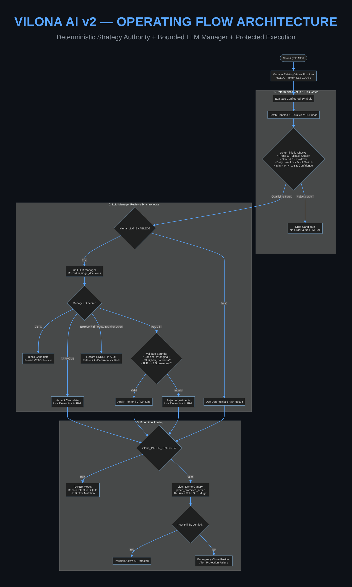
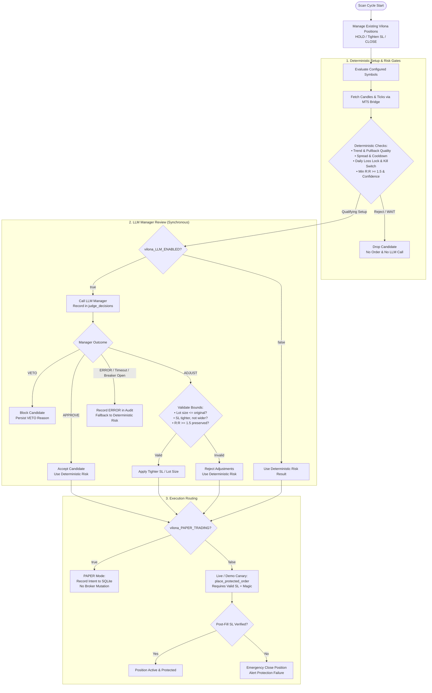

# Vilona AI v2 — Current Operating Flow

## Status

**Current release state: NOT READY for real-account trading.**

The system is allowed to run in PAPER mode and may be promoted to a controlled demo canary only after the readiness gates in [`production-readiness-checklist.md`](production-readiness-checklist.md) are evidenced.

## Runtime flow





1. `app_server.py` loads configuration and creates the configured MT5 or MT5-MCP bridge.
2. `QuantScanner.scan_cycle()` manages existing positions, then evaluates configured symbols.
3. Deterministic setup logic checks market data, trend/pullback quality, spread, cooldown, exposure, daily loss, kill switch, confidence, SL/TP, and minimum R:R.
4. A rejected setup produces no order and no LLM manager call.
5. A qualifying deterministic candidate is recorded in `judge_decisions` and, when enabled, sent to the synchronous LLM manager.
6. The entry manager returns `APPROVE`, `VETO`, or `ADJUST`.
7. `VETO` blocks the candidate. `APPROVE` continues with the deterministic risk result. `ADJUST` is accepted only when lot size does not increase, the stop is no wider, the stop is on the correct side, the broker minimum distance is respected, and R:R remains at least `1.5`.
8. Timeout, malformed response, transport failure, invalid adjustment, or circuit-open state is recorded as `ERROR`. The original deterministic risk result remains the fallback; no manager-generated exposure is used.
9. PAPER mode records a simulated order and performs no broker mutation.
10. Live mode submits through `place_protected_order()`. The order must include an SL, use a Vilona magic number, and pass post-fill SL verification. Failure to verify protection triggers a close attempt and records rejection.
11. Open Vilona-owned positions are identified by the `MAGIC_BASE` range. The position manager may return `HOLD`, `MODIFY`, or `CLOSE`. `MODIFY` may only tighten SL; manual or foreign positions are not managed by the LLM.

## Configuration modes

### PAPER with manager

```env
vilona_EXCHANGE=mt5
vilona_MT5_TRANSPORT=mcp
vilona_LLM_ENABLED=true
vilona_PAPER_TRADING=true
vilona_PERSONAS=trader,risk_manager,judge
```

Use this mode for soak evidence. It exercises deterministic setup selection, manager parsing, audit persistence, circuit-breaker behavior, and paper intent recording without sending broker mutations.

### PAPER without manager

```env
vilona_LLM_ENABLED=false
vilona_PAPER_TRADING=true
```

No LLM request is made. Deterministic trader, risk manager, break-even manager, and paper-recording paths remain active.

### Live/demo canary

```env
vilona_EXCHANGE=mt5
vilona_MT5_TRANSPORT=mcp
vilona_LLM_ENABLED=true
vilona_PAPER_TRADING=false
vilona_PERSONAS=trader,risk_manager,judge
```

This mode is not approved by default. It requires Gate A, a controlled one-symbol canary plan, valid broker credentials, and explicit human approval. Start with minimum volume and one open position maximum.

## Failure and rollback rules

- Kill switch or daily-loss lock: block new entries immediately.
- Deterministic setup/risk failure: do not call the manager and do not trade.
- Manager failure: record `ERROR`; use deterministic fallback for entry flow.
- Protected-order failure: do not leave an unverified position open; close it when possible and alert.
- Unexpected broker, bridge, or cleanup failure: stop the canary and return to PAPER mode.
- Emergency rollback: set `vilona_PAPER_TRADING=true`, restart through `scripts/run_app_server.sh`, and verify the process environment.

```bash
pid=$(pgrep -o -f '[a]pp_server.py')
tr '\0' '\n' </proc/$pid/environ | grep -E '^vilona_(EXCHANGE|MT5_TRANSPORT|LLM_ENABLED|PAPER_TRADING|PERSONAS)='
```

Then confirm the kill-switch file and broker state before any restart to live mode.

## Required evidence before promotion

### Gate A — PAPER soak

- At least `50` fresh judge decisions.
- At least `50` distinct paper setups.
- Manager infrastructure error rate at or below `10%`.
- Valid approval share; `ERROR` must not be counted as `VETO`.
- No duplicate setup inflation.
- Soak report shows `READY`.

```bash
PYTHONPATH=. /tmp/vilvenv/bin/python scripts/judge_soak_report.py --since-hours 24
```

### Gate B — Demo canary

- Protected-order E2E already passed.
- One real qualifying setup; do not force a synthetic signal.
- One symbol, minimum volume, maximum one position.
- Verify fill, SL, TP, ownership magic, manager behavior, cleanup, and account position count.
- Abort on bridge health, SL verification, daily-loss, or cleanup failure.

### Gate C — Real account

- Gates A and B complete.
- Compare deterministic baseline against paper/canary expectancy, profit factor, win rate, and max drawdown.
- Exercise kill switch and daily-loss shutdown.
- Confirm rollback procedure.
- Obtain explicit human approval for credentials and risk limits.

Passing tests alone does not satisfy these gates. Real broker and model-provider evidence is required.
