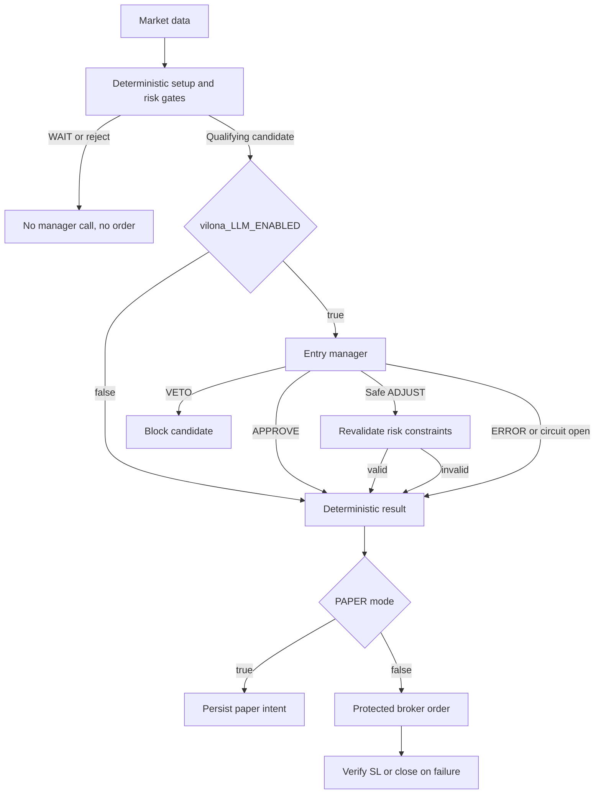

# Paper Trading Audit — Vilona AI v2

## Executive status

**Status: PAPER-allowed, real-account NOT READY.**

The automated regression suite currently passes `224 passed, 3 skipped`. This proves code behavior covered by tests; it does not prove upstream LLM reliability or production broker readiness.

Current promotion blockers are tracked in [`production-readiness-checklist.md`](production-readiness-checklist.md). The operational sequence is documented in [`operating-flow.md`](operating-flow.md).

## Paper-mode contract

When `vilona_PAPER_TRADING=true`:

- Deterministic scanning and risk evaluation still run.
- Enabled LLM entry decisions still run and are audited.
- Qualifying candidates are recorded as paper intents.
- `send_market_order`, `modify_position_sltp`, and `close_position` are not used for execution.
- No broker mutation is permitted by the scanner.

The root `config.paper_trading` value is the source of truth. `config.trading.paper_trading` mirrors the same value for compatibility. `tests/test_paper_mode_guard.py` and `tests/test_paper_flag_source_of_truth.py` cover the invariant.

## Current decision flow



The LLM is a bounded manager, not an unrestricted broker client. It cannot create an entry from `WAIT`, increase lot size, widen the deterministic stop, remove protection, bypass the kill switch, bypass daily-loss locks, or bypass protected-order verification.

## LLM manager behavior

`vilona_LLM_ENABLED` is the only manager switch:

| Setting | Behavior |
|---|---|
| `false` | No LLM request. Deterministic trader, risk manager, break-even manager, and paper/live protected-order paths remain active. |
| `true` | Qualifying entries receive `APPROVE`, `VETO`, or bounded `ADJUST` review. Vilona-owned live positions may receive `HOLD`, stop-tightening `MODIFY`, or `CLOSE`. |

Position management is limited to positions in the Vilona magic range. Manual or foreign positions are not LLM-managed. PAPER mode disables all position mutations.

## Failure policy

| Failure | Result |
|---|---|
| Deterministic setup or risk failure | No manager call; no order |
| LLM timeout, malformed/empty response, transport error | Persist `ERROR`; use deterministic fallback |
| Circuit breaker open | Persist `CircuitOpenError`; use deterministic fallback |
| Manager `VETO` | Block candidate entry |
| Invalid `ADJUST` | Reject adjustment; preserve deterministic values |
| Protected-order verification failure | Reject order and attempt close |
| Kill switch or daily-loss lock | Block new entries |

`ERROR` is separate from substantive `VETO` in the audit table. It must not be counted as a model veto.

## Audit records

Entry manager decisions are written to `judge_decisions` with:

| Field | Meaning |
|---|---|
| `symbol`, `action`, `confidence` | Proposed setup |
| `risk_approved`, `lot_size`, `sl`, `tp` | Deterministic risk result or accepted bounded adjustment |
| `verdict` | `APPROVE`, `VETO`, or `ERROR` |
| `reason` | Manager reason or fallback/error detail |
| `latency_ms` | Manager round-trip duration |
| `error` | Stable infrastructure/action error class |
| `created_at` | Persisted event time |

Paper order intents are persisted separately through the existing order-record path. Setup keys prevent duplicate intent inflation after repeated scans or restart.

## Verification commands

Run the complete regression suite:

```bash
PYTHONPATH=. /tmp/vilvenv/bin/python -m pytest -q
# Expected current result: 224 passed, 3 skipped
```

Run the paper and manager subset:

```bash
PYTHONPATH=. /tmp/vilvenv/bin/python -m pytest -q \
  tests/test_llm_manager.py \
  tests/test_scanner_judge_audit.py \
  tests/test_scanner_judge_breaker.py \
  tests/test_paper_mode_guard.py \
  tests/test_paper_flag_source_of_truth.py
```

Generate soak evidence:

```bash
PYTHONPATH=. /tmp/vilvenv/bin/python scripts/judge_soak_report.py --since-hours 24
```

## Promotion status

The following remain required before real-account trading:

- `50` fresh judge decisions.
- `50` distinct paper setups.
- Manager infrastructure error rate `<=10%`.
- Valid approval share.
- One-symbol demo canary with real qualifying setup.
- Baseline comparison: expectancy, profit factor, win rate, max drawdown.
- Controlled kill-switch and daily-loss shutdown evidence.
- Human approval for credentials and risk limits.

The current model/provider reliability sample is insufficient. A passing unit suite does not replace PAPER soak or broker canary evidence.
