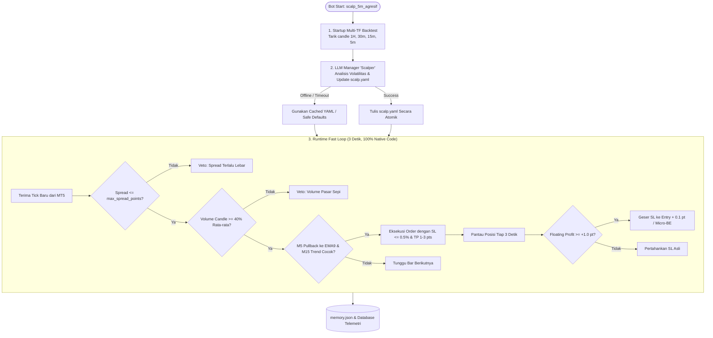

# Panduan Lengkap Strategi Trading Vilona AI (Trading Strategies & Configuration Guide)

Dokumen ini menjelaskan seluruh strategi trading yang didukung oleh bot Vilona AI, cara kerja masing-masing strategi, matriks parameter konfigurasi (`.env` dan `scalp.yaml`), serta panduan operasional.

---

## 1. Daftar Strategi yang Didukung

Bot Vilona AI mendukung 4 strategi utama yang dipilih melalui variabel lingkungan `KINGAI_STRATEGY`:

| Nilai `KINGAI_STRATEGY` | Nama Strategi | Karakteristik Utama | Timeframe Utama | Tipe Eksekusi |
| :--- | :--- | :--- | :---: | :---: |
| `scalp_5m_agresif` | **Standalone AI Micro-Scalper** | Frekuensi tinggi, startup auto-backtest, TP tipis 1–3 poin, SL $\le 0.5\%$, Micro-BE. | 5m (Filter 15m & 1H) | Native 3s Loop (Decoupled AI) |
| `scalp_5m` | **Legacy Trend Scalper** | Pullback M5 searah tren M15 EMA 21/50, SL/TP berbasis ATR dinamis. | 5m & 15m | Synchronous Scanner Loop |
| `pullback` *(Default)* | **15m Swing Trend Follower** | Pullback candle M15 ke area EMA 21/50 searah tren H1 dengan TP 3x ATR. | 15m & 1H | Synchronous Scanner Loop |
| `breakout` | **15m Range Breakout** | Penembusan Donchian/High-Low 20 bar M15 yang terkonfirmasi oleh EMA 1H. | 15m & 1H | Synchronous Scanner Loop |

---

## 2. Strategi Baru: Standalone `scalp_5m_agresif`

### 2.1 Filosofi & Arsitektur Dual-Loop
Strategi ini dirancang khusus untuk instrumen cepat seperti **XAUUSD (Gold)** dan pasangan Forex mikro pada akun Cent (`XAUUSDc`, `EURUSDc`) maupun Standard.

Sistem memisahkan secara tegas antara **AI Planner (Slow Loop)** dan **Native Execution Engine (Fast Loop)**:



### 2.2 Cara Kerja & Fitur Kunci:
1. **Startup Auto-Backtest 1x:**
   Saat server boot, bot mengumpulkan 80 candle 1H, 80 candle 30m, 80 candle 15m, dan 100 candle 5m untuk mengevaluasi bias tren, rentang ATR, dan rata-rata spread.
2. **LLM Manager "Scalper":**
   Mengonsumsi hasil JSON backtest dan telemetri `memory.json`. LLM merumuskan parameter optimal (TP 1–3 poin, SL terukur, batas spread) dan menuliskannya ke `scalp.yaml`.
3. **Resiliensi AI Disconnect (Fault-Tolerant):**
   Jika API LLM offline, timeout, atau kuota habis, strategi **tidak berhenti dan tidak melempar error**. Sistem langsung mengadopsi rekomendasi kuantitatif native dan melanjutkan trading tanpa gangguan.
4. **Server-Side Protected Order:**
   Setiap order dipasang dengan level SL dan TP langsung di server MT5 broker. Begitu harga menyentuh target, likuidasi berlangsung dalam hitungan milidetik (*zero network latency*).
5. **Micro-Breakeven (Micro-BE):**
   Begitu harga bergerak menguntungkan $\ge +1.0$ poin, Stop Loss otomatis dipindahkan ke harga beli $+0.1$ poin untuk mengunci modal dan mengeliminasi risiko berbalik rugi.
6. **Continuous Memory Telemetry:**
   Seluruh kejadian pasar, spread min/max/avg, slippage, durasi trade, dan status exit (TP_HIT/SL_HIT) disimpan di `memory.json` dan `scalper.json`.

---

## 3. Strategi Bawaan Lainnya (Legacy & Core Strategies)

### 3.1 Strategi `pullback` (Default Core)
* **Karakteristik:** Mengikuti tren swing berbasis candle 15 menit.
* **Logika Entry:**
  * **Tren Makro (1H):** Ditentukan oleh perpotongan EMA 21 dan EMA 50 pada candle 1 jam.
  * **Pemicu Entry (15m):** Harga pada candle 15 menit mengalami koreksi (*pullback*) mendekati EMA 21 (maksimal dalam rentang $1.2 \times ATR_{15m}$).
  * **Take Profit:** Berbasis ekspansi tren lebar, yaitu $3.0 \times ATR_{15m}$.
  * **Stop Loss:** Diletakkan di $1.5 \times ATR_{15m}$ dari harga beli.
* **Kelebihan:** Risk-to-reward besar ($\ge 1:2$), meminimalisir transaksi berlebih di pasar sideways.

### 3.2 Strategi `breakout` (Range Breakout)
* **Karakteristik:** Menangkap momentum penembusan harga dari area konsolidasi.
* **Logika Entry:**
  * Menghitung nilai tertinggi (*highest high*) dan terendah (*lowest low*) dari 20 candle 15-menit terakhir (`KINGAI_BREAKOUT_LOOKBACK=20`).
  * **BUY:** Harga menembus level tertinggi 20 bar M15 saat tren 1H EMA 21 > EMA 50.
  * **SELL:** Harga menembus level terendah 20 bar M15 saat tren 1H EMA 21 < EMA 50.
  * **Take Profit & Stop Loss:** Menggunakan kelipatan ATR dinamis (`tp_atr_mult` dan `sl_atr_mult`).

### 3.3 Strategi `scalp_5m` (Legacy 5M Pullback)
* **Karakteristik:** Scalping M5 generasi pertama sebelum arsitektur decoupled dibuat.
* **Logika Entry:**
  * Menggunakan arah tren EMA 21/50 pada candle 15 menit.
  * Menembus atau memantul pada batas `scalp_pullback_band` $\times ATR_{5m}$ di candle 5-menit.
  * Mengandalkan approval LLM sinkron per-trade (yang memiliki latensi 3–15 detik).

---

## 4. Panduan Konfigurasi (`.env` dan `scalp.yaml`)

### 4.1 Variabel Lingkungan Utama (`.env`)

```ini
# =====================================================================
# PENGATURAN EXCHANGE & KONEKSI BROKER
# =====================================================================
KINGAI_EXCHANGE=mt5                          # mt5 | bybit | binance
KINGAI_MT5_TRANSPORT=mcp                     # mcp (Semua OS) | package (Windows lokal)
KINGAI_MT5_MCP_URL=http://127.0.0.1:8765     # Endpoint bridge MT5 MCP server
KINGAI_MT5_MCP_TIMEOUT=30                    # Timeout komunikasi MCP (detik)

# =====================================================================
# PEMILIHAN STRATEGI TRADING
# =====================================================================
# Pilihan: scalp_5m_agresif | scalp_5m | pullback | breakout
KINGAI_STRATEGY=scalp_5m_agresif

# Simbol instrumen yang diperdagangkan (pisahkan koma jika multi-symbol)
KINGAI_SYMBOLS=XAUUSDc

# =====================================================================
# PENGAMAN AKUN & RISK LIMITS (BERLAKU UNTUK SEMUA STRATEGI)
# =====================================================================
KINGAI_PAPER_TRADING=true                    # true: simulasi lokal | false: order live riil
KINGAI_MAX_RISK_PCT=0.5                      # Batas toleransi risiko per order (%)
KINGAI_MAX_DAILY_LOSS_PCT=3.0                # Batas maksimal kerugian harian (%)
KINGAI_MAX_CONCURRENT_POSITIONS=1            # Maksimal posisi terbuka bersamaan
KINGAI_MAX_POSITIONS_PER_SYMBOL=1            # Maksimal posisi per simbol
KINGAI_SYMBOL_COOLDOWN_SECONDS=120           # Waktu jeda antar order (detik)
KINGAI_MAX_LOT=2.0                           # Batas absolut ukuran lot

# =====================================================================
# KONEKSI LLM / AGENT ORCHESTRATOR
# =====================================================================
KINGAI_LLM_ENABLED=true
KINGAI_LLM_PROVIDER=openrouter
KINGAI_LLM_API_KEY=your-api-key-here
KINGAI_LLM_BASE_URL=http://100.104.99.26:20128/v1
KINGAI_LLM_MODEL=pr/claude-opus-5-5
KINGAI_LLM_TIMEOUT=60
```

---

### 4.2 File Konfigurasi Dinamis (`scalp.yaml`)

File ini hanya digunakan saat `KINGAI_STRATEGY=scalp_5m_agresif`. File ini di-update secara otomatis oleh LLM Scalper, namun juga dapat disunting manual:

```yaml
version: 1.0.0
generated_at: '2026-11-17T07:58:05Z'
market_regime: trending_up             # ranging_low_volatility | trending_up | trending_down | moderate

ai_orchestrator:
  last_run_status: SUCCESS             # SUCCESS | DISCONNECTED | AI_OFFLINE_NATIVE_ACTIVE
  model_used: pr/claude-opus-5-5

global_settings:
  active: true                         # Master switch strategi scalping
  max_concurrent_scalp_positions: 1
  max_risk_per_trade_pct: 0.5          # Batas keras persentase risiko Stop Loss (Maks 0.5%)
  emergency_hard_sl_points: 15.0       # Batas pengaman darurat absolut SL (poin)

symbols:
  XAUUSDc:                             # Simbol Akun Cent Emas
    enabled: true
    tp_points: 1.8                     # Target Take Profit tipis (1.0 - 3.0 poin)
    sl_points: 6.0                     # Stop Loss ketat (5.0 - 15.0 poin)
    micro_be_points: 1.0               # Geser SL ke BE setelah profit mencapai +1.0 poin
    max_spread_points: 1.0             # Tolak transaksi jika spread pasar > 1.0 poin
    risk_per_trade_pct: 0.5            # Persentase risiko per transaksi
    fixed_lot: 0.01                    # Lot dasar
    use_fixed_lot: true                # true: gunakan fixed_lot | false: hitung lot otomatis
    auto_scale_lot: true               # DYNAMIC AUTO-RESIZE LOT (0.01 -> 0.05 -> maks 0.50 berdasarkan kekuatan tren)
    lot_min_scale: 0.01                # Batas bawah lot
    lot_max_scale: 0.50                # Batas atas lot maksimal
    min_confidence: 0.54               # Ambang batas probabilitas sinyal (0.0 - 1.0)
    cooldown_bars: 1                   # Jeda candle M5 setelah trade ditutup
    indicators:
      ema_fast: 9
      ema_slow: 21
      trend_filter_ema: 50             # EMA filter pada candle 15m
      rsi_period: 14
      rsi_overbought: 70.0
      rsi_oversold: 30.0
      atr_multiplier_band: 1.2
    weights:
      tf_1h: 0.40
      tf_30m: 0.35
      tf_15m: 0.25
```

---

## 5. Matriks Perbandingan Parameter Antar-Strategi

| Parameter | `scalp_5m_agresif` | `scalp_5m` (Legacy) | `pullback` (Default) | `breakout` |
| :--- | :---: | :---: | :---: | :---: |
| **Sumber Config** | `scalp.yaml` (Dinamis) | `.env` / `TradingConfig` | `.env` / `TradingConfig` | `.env` / `TradingConfig` |
| **Target TP** | **Tipis 1.0 – 3.0 poin** | $3.0 \times ATR_{5m}$ | $3.0 \times ATR_{15m}$ | $3.0 \times ATR_{15m}$ |
| **Batas SL** | **Ketat $\le 0.5\%$ Equity** | $1.5 \times ATR_{5m}$ | $1.5 \times ATR_{15m}$ | $1.5 \times ATR_{15m}$ |
| **Micro-Breakeven** | **Otomatis di $+1.0$ pt** | Tidak ada | Standar BE ($+1.0$ ATR) | Standar BE ($+1.0$ ATR) |
| **Filter Spread** | **Poin Absolut ($\le 1.5$ pt)** | Persentase / Spread ATR | Persentase global | Persentase global |
| **Filter Volume** | **Tick Volume Active $\ge 40\%$** | Tidak ada | Tidak ada | Tidak ada |
| **Peran LLM / AI** | **Offline Orchestrator (0ms latency)** | Blocking Judge per-trade | Blocking Judge per-trade | Blocking Judge per-trade |
| **Ketahanan AI Off** | **100% Tetap Jalan (Native)** | Fallback deterministik | Fallback deterministik | Fallback deterministik |

---

## 6. Prosedur Operasional & Monitoring

### 6.1 Menjalankan Bot
```bash
# Menggunakan script runner standar (memuat .env otomatis)
./scripts/run_app_server.sh

# Atau langsung via Python
PYTHONPATH=. python app_server.py
```

### 6.2 Memantau Log di Terminal / Dashboard
Saat bot dinyalakan dengan strategi `scalp_5m_agresif`, layar dashboard akan menampilkan urutan berikut:
1. `[SCALPER BACKTEST] Initializing automated multi-timeframe backtest...`
2. `[SCALPER BACKTEST] XAUUSDc Complete: WinRate=..., Rec TP=...pts, Rec SL=...pts`
3. `[SCALPER AI] Configuration updated into scalp.yaml | Status: SUCCESS`
4. `[trader] XAUUSDc: [SCALP-5M] BUY/SELL signal conf=0.8x...`
5. `[SCALP-5M] EXECUTE BUY/SELL XAUUSDc: lot=0.01 SL=... TP=... (spread=...)`
6. `[SCALP-5M] MICRO-BE ACTIVATED: profit=+1.xx pts -> Move SL to ...`
7. `[SCALP-5M] TP HIT: exit=... profit=+1.xx pts`

### 6.3 Memeriksa Catatan Telemetri
* **Riwayat 50 Transaksi & Spread Live:** Buka file [`memory.json`](memory.json).
* **Evaluasi Sesi Jangka Panjang:** Buka file `scalper.json` atau database SQLite `vilona_v2.db`.
