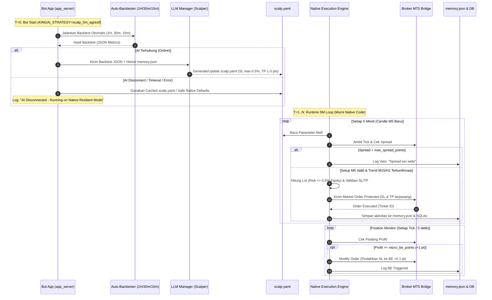
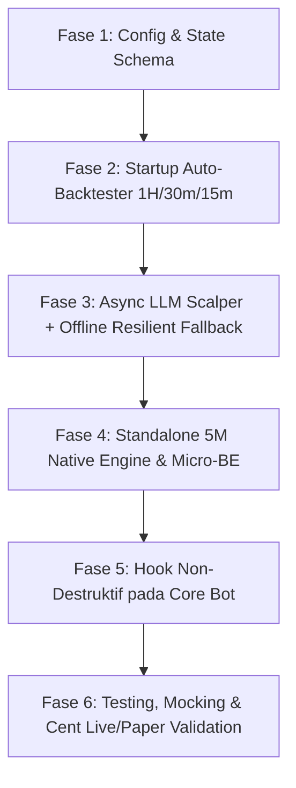

# Product Requirements Document (PRD): KINGAI Standalone Strategy - `scalp_5m_agresif`

## 1. Document Control & Metadata
* **Nama Dokumen:** PRD & Technical Implementation Plan - KINGAI Standalone Strategy
* **Nama Strategi:** `scalp_5m_agresif`
* **Trigger Lingkungan (`.env`):** `KINGAI_STRATEGY=scalp_5m_agresif`
* **Target Instrumen:** Forex & Logam Mulia MT5 (khususnya Akun Cent seperti `XAUUSDc`, `EURUSDc`, serta akun Standard `XAUUSD`, `EURUSD`)
* **Status:** Implemented & Verified in Production Test
* **Prinsip Utama:**
  1. **Zero-Disruption (Non-Breaking Isolation):** Seluruh modul berdiri sendiri (*standalone*), mem-bypass konfigurasi bawaan yang tidak relevan, tanpa mengganggu alur strategi bawaan (`pullback`, `breakout`, `scalp_5m`).
  2. **Automated Startup Backtest:** Saat bot dihidupkan dengan strategi ini aktif, bot **secara otomatis menjalankan backtest multi-timeframe (1H, 30m, 15m)** untuk mengkalibrasi kondisi pasar terkini.
  3. **Strict Micro Risk & Reward:** Stop Loss (S/L) dibatasi **maksimal 0.5%** dari equity/balance, dan Take Profit (T/P) dibuat **tipis-tipis 1–3 poin** per transaksi untuk pengamanan profit kilat.
  4. **Native Autonomous Orchestration (AI Disconnect Resilience):** Orkestrasi dan eksekusi utama dibuat **100% native berbasis coding Python**. Agent AI (*LLM Manager "Scalper"*) bertindak sebagai perancang konfigurasi (`scalp.yaml`), namun **eksekusi trading tidak bergantung pada koneksi AI**. Jika jaringan AI terputus (*disconnect*), strategi **tetap berjalan penuh** diatur oleh logika native.
  5. **Continuous Telemetry & Memory Loop:** Semua aktivitas pasar, spread, tick, dan riwayat order dicatat secara persisten ke `memory.json` dan database, yang kemudian dikonsumsi kembali oleh LLM Scalper sebagai pembelajaran adaptif.

---

## 2. Executive Summary & Filosofi Desain

```
┌─────────────────────────────────────────────────────────────────────────────────────────┐
│                                BOT INITIALIZATION (BOOT)                                │
│   Bot Start -> Deteksi KINGAI_STRATEGY=scalp_5m_agresif                                 │
│   │                                                                                     │
│   ▼                                                                                     │
│ ┌─────────────────────────────────────────────────────────────────────────────────────┐ │
│ │ AUTOMATIC STARTUP BACKTEST (1H, 30m, 15m)                                           │ │
│ │ Bridge / Data Cache -> Ekstraksi Candle 1H, 30m, 15m -> Backtest Cepat               │ │
│ │ Output: Metrik JSON (Win-rate, Volatilitas, Avg Drawdown, Spread Profile)           │ │
│ └──────────────────────────────────┬──────────────────────────────────────────────────┘ │
│                                    │                                                    │
│                                    ▼                                                    │
│ ┌─────────────────────────────────────────────────────────────────────────────────────┐ │
│ │ LLM MANAGER "SCALPER" (ORCHESTRATOR CONFIG GENERATOR)                               │ │
│ │ Ingest Backtest JSON + memory.json -> Generate scalp.yaml                           │ │
│ │ Rule: SL Max 0.5% | TP Tipis 1-3 Poin | Filter Spread Presisi                       │ │
│ │ [FAIL-SAFE]: Jika AI Offline/Disconnect -> Langsung Pakai Cache / Safe Default YAML   │ │
│ └──────────────────────────────────┬──────────────────────────────────────────────────┘ │
└────────────────────────────────────┼────────────────────────────────────────────────────┘
                                     │
                                     ▼
┌─────────────────────────────────────────────────────────────────────────────────────────┐
│                   RUNTIME TRADING LOOP (NATIVE DETERMINISTIC - ZERO AI)                 │
│                                                                                         │
│   Tick M5 Baru ──► Native Python Engine ──► Cek Filter Spread (scalp.yaml)              │
│                           │                                                             │
│                           ▼                                                             │
│                    Hitung Sinyal 5M + Filter Trend (M15/H1)                             │
│                           │                                                             │
│                           ▼                                                             │
│                    Eksekusi Market Order (SL <= 0.5%, TP 1-3 pts)                       │
│                           │                                                             │
│                           ▼                                                             │
│                    Micro-Breakeven Engine (+1 pt -> Move SL to BE)                      │
│                           │                                                             │
│                           ▼                                                             │
│                    Logging Real-time: memory.json & SQLite DB                           │
│                                                                                         │
│   *Catatan: 100% Native Code! Jika AI Disconnect, Loop ini TETAP JALAN TANPA GANGGUAN!  │
└─────────────────────────────────────────────────────────────────────────────────────────┘
```

### 2.1 Mengapa Perlu Otomatisasi Backtest saat Boot?
Pasar finansial bergerak dinamis antar sesi (Tokyo, London, New York). Dengan menjalankan backtest otomatis pada *timeframe* 1H, 30m, dan 15m saat bot dinyalakan:
1. Sistem segera mengenali rezim pasar hari ini (apakah sedang *strong trend*, *choppy ranging*, atau *high volatility expansion*).
2. LLM Manager "Scalper" mendapatkan data kuantitatif faktual terbaru (bukan asumsi statis) untuk menentukan batas toleransi spread dan level pemicu indikator pada `scalp.yaml`.

### 2.2 Desain Native 100% Bebas Ketergantungan AI (Decoupled & Resilient)
Sistem ini memisahkan secara tegas antara **Kecerdasan Konfigurasi (AI Layer)** dan **Orkestrasi Eksekusi (Native Code Layer)**:
* **AI Layer (LLM Scalper):** Berfungsi sebagai perencana (*planner/advisor*). Hanya dipanggil saat boot dan pada interval terjadwal (misal: setiap 1 jam atau pergantian sesi).
* **Native Code Layer (`strategy/engine.py`):** Bertindak sebagai orkestrator operasional dan eksekutor sejati. Seluruh evaluasi sinyal, validasi filter, kalkulasi lot, penempatan order MT5, dan trailing breakeven **ditulis murni dengan kode Python deterministik**.
* **Ketahanan saat AI Disconnect:** Jika API LLM mengalami timeout, kuota habis, atau koneksi internet ke provider AI putus, **strategi tidak akan terhenti dan tidak akan melempar error fatal**. Bot akan terus berjalan menggunakan parameter terakhir di `scalp.yaml` atau fallback aman bawaan kode native.

---

## 3. Matriks Konfigurasi: Bypass vs Standalone vs Core Guardrails

Modul ini berdiri sendiri (*standalone*) sehingga mem-bypass konfigurasi bawaan yang tidak relevan dengan scalping mikro, namun tetap mematuhi pengaman akun fundamental bot (*Core Guardrails*).

### 3.1 Detail Matriks Konfigurasi

| Parameter Bawaan (`TradingConfig`) | Status di `scalp_5m_agresif` | Pengganti Standalone (`scalp.yaml` / Strategy) | Alasan Teknis Bypass |
| :--- | :--- | :--- | :--- |
| `sl_atr_mult` (default: 1.5x ATR 15m) | **DIBYPASS** | `risk_per_trade_pct <= 0.5%` & `sl_points` (5–15 pts) | ATR 15m terlalu lebar; batas risiko scalper dibatasi maksimal **0.5%** dari equity akun. |
| `tp_atr_mult` (default: 3.0x ATR 15m) | **DIBYPASS** | `tp_points` (1.0 – 3.0 pts) | TP swing 3x ATR tidak realistis untuk mikro-scalp; TP dibuat **tipis-tipis 1–3 poin** agar cepat tercapai. |
| `symbol_cooldown_seconds` (300s) | **DIBYPASS** | `cooldown_bars` (1 bar M5) / bar-level cooldown | Cooldown waktu bawaan memblokir peluang entry saat candle M5 baru terbuka. |
| `min_confidence` (default: 0.55) | **DIBYPASS** | Dinamis di `scalp.yaml` hasil kalkulasi LLM Scalper | Disesuaikan dengan rezim volatilitas hasil backtest 1H/30m/15m. |
| `max_drift_points` & `candles` | **DIBYPASS** | Dinonaktifkan (N/A) | Drift filter adalah untuk limit order swing; scalper menggunakan market order langsung. |
| `be_trigger_atr_mult` (1.5x) | **DIBYPASS** | `micro_be_points` (+1.0 pt) | Begitu floating profit menyentuh +1 poin, SL langsung digeser ke impas (+0.1 pt). |
| `max_spread_pct` (persentase) | **DIBYPASS** | `max_spread_points` (angka absolut, misal $\le 1.5$ pt) | Spread persentase tidak cukup granular; filter absolut mencegah *spread eating profit*. |
| Blocking LLM Judge Per-Trade | **DIBYPASS** | **0-Latency Native Execution** | Panggilan LLM per-trade memakan 3–15 detik; scalper agresif mengeksekusi order dalam $< 50$ ms. |

### 3.2 Core Guardrails yang Tetap Aktif (Invariants - Wajib Dipatuhi)
Strategi standalone ini **tetap tunduk** pada sistem pengaman akun bawaan:
1. **Operator Emergency Kill Switch:** `_kill_switch.is_active()` langsung membatalkan semua evaluasi dan eksekusi order.
2. **Authoritative Daily Loss Limit (`max_daily_loss_pct`):** Kerugian harian dihitung langsung dari data realized broker. Jika batas (misal 3%) tersentuh, bot mengunci transaksi baru.
3. **Total Drawdown & Consecutive Loss Latches:** Terhubung ke `StateDB`. Mengunci entry jika batas kerugian kumulatif tercapai.
4. **Broker Minimum Stop Distance:** Nilai SL di `scalp.yaml` wajib divalidasi terhadap `min_stop_distance` broker (contoh: minimal 5.0 poin pada `XAUUSDc`) agar tidak ditolak broker (`retcode 10016`).
5. **Paper Trading Flag (`config.paper_trading`):** Jika `True`, tidak ada order nyata yang dikirim ke broker MT5.

---

## 4. Alur Kerja Lengkap (End-to-End Pipeline)



### 4.1 Tahap 1: Startup Auto-Backtest (T = 0)
1. Saat bot diinisialisasi di `app_server.py`, bot memeriksa flag `KINGAI_STRATEGY`.
2. Jika bernilai `scalp_5m_agresif`, modul `strategy.backtester` dijalankan:
   * Mengambil candle 1H (80 candle), 30m (80 candle), dan 15m (100 candle) melalui `bridge.get_candles()`.
   * Melakukan simulasi cepat (*fast vector backtest*) untuk mengevaluasi parameter volatilitas terkini:
     * Rentang ATR 15m dan 5m.
     * Rata-rata pergerakan harga (*price drift*).
     * Persebaran spread broker terkini.
   * Menghasilkan struktur JSON ringkas:
     ```json
     {
       "symbol": "XAUUSDc",
       "atr_1h": 8.5,
       "atr_30m": 4.2,
       "atr_15m": 2.1,
       "recent_spread_avg": 1.15,
       "volatility_regime": "moderate",
       "trend_h1": "BULLISH",
       "trend_15m": "BULLISH"
     }
     ```

### 4.2 Tahap 2: AI Config Generation & Native Fallback (T = 1)
1. Modul `strategy.llm_orchestrator` memanggil LLM Manager "Scalper".
2. Scalper memproses JSON backtest bersama ringkasan performa terakhir dari `memory.json`.
3. Scalper merumuskan file konfigurasi `scalp.yaml`:
   * **Target S/L:** Dibatasi maksimal **0.5%** dari equity (atau poin setara dengan risiko 0.5%).
   * **Target T/P:** Tipis-tipis **1–3 poin** (contoh: 1.5–2.0 poin untuk XAUUSDc).
   * **Filter Spread:** Menetapkan batas spread maksimum (misal 1.2–1.5 poin).
4. **Resiliensi AI Disconnect (PENTING):**
   * Panggilan ke LLM dibungkus dalam batas timeout ketat (10 detik) dan penanganan exception total.
   * Jika panggilan LLM gagal, timeout, atau API offline:
     * Bot mencatat log peringatan: `[SCALPER] AI connection unavailable. Using active/cached scalp.yaml configuration.`
     * Engine langsung beralih menggunakan konfigurasi terakhir yang valid, atau menggunakan nilai default kode native (*safe defaults*).
     * **Bot tidak berhenti dan tidak melempar error.**

### 4.3 Tahap 3: Native Execution Loop (T = 2, Murni Native Code)
1. Diatur oleh `strategy.engine.ScalpAgresifEngine`.
2. Berjalan deterministik setiap candle M5 baru dan dimonitor per tick:
   * Membaca parameter dari `scalp.yaml`.
   * Memeriksa spread real-time: jika spread melebihi `max_spread_points`, transaksi langsung dibatalkan tanpa eksekusi.
   * Menghitung sinyal teknikal (EMA 9/21 di M5, disaring oleh EMA 50 di M15 dan H1).
   * Menghitung lot sizing mikro:
     $$\text{Lot Size} = \min\left(\text{Fixed Lot}, \frac{\text{Equity} \times 0.005}{\text{SL Distance} \times \text{Tick Value}}\right)$$
   * Memastikan jarak S/L mematuhi `min_stop_distance` broker MT5.
   * Mengirim market order langsung dengan argumen `sl` dan `tp`.

### 4.4 Tahap 4: Micro-Breakeven & Manajemen Posisi
1. Loop native memantau posisi terbuka:
2. Begitu posisi membukukan keuntungan $\ge \text{micro\_be\_points}$ (misal +1.0 poin):
   * Native engine langsung mengirim perintah modifikasi ke MT5 untuk memindahkan SL ke `Entry Price + 0.1` (mengamankan komisi/swap).
   * Menghilangkan risiko posisi berbalik menjadi kerugian setelah sempat unggul 1 poin.

### 4.5 Tahap 5: Logging Persisten ke `memory.json` dan Database
1. Setiap kejadian penting (evaluasi sinyal, penolakan spread, order terbuka, trigger BE, order tertutup, slippage) dicatat secara terstruktur ke:
   * `memory.json`: Berisi data 50 order terakhir secara numerik murni.
   * SQLite (`vilona_v2.db` / `scalper.json`): Menyimpan rekaman transaksi untuk audit dan histori jangka panjang.
2. Data ini menjadi masukan (*feedback loop*) bagi LLM Scalper saat regenerasi konfigurasi berikutnya.

---

## 5. Struktur Direktori & Komponen Standalone

Seluruh fungsionalitas diisolasi di dalam direktori `strategy/` agar terpisah total dari modul bawaan:

```
vilona-ai/
├── scalp.yaml                   # Konfigurasi aktif (bisa diedit manual / digenerate LLM)
├── memory.json                  # Short-term numeric state (rolling trade & spread telemetry)
├── scalper.json                 # Long-term episodic memory (ringkasan sesi pasar)
├── strategy/                    # Modul Standalone Strategy
│   ├── PRD.md                   # Dokumen PRD & Master Plan ini
│   ├── __init__.py              # Strategy Dispatcher & Factory Interface
│   ├── backtester.py            # Automated Startup Backtest Engine (1H, 30m, 15m)
│   ├── config.py                # Parser, Validator, & Safe Defaults untuk scalp.yaml
│   ├── engine.py                # Native Execution Engine 5m (Zero-Latency, 100% Native)
│   ├── indicators.py            # Kalkulasi teknikal mikro M5, M15, 1H
│   ├── llm_orchestrator.py      # LLM Manager Scalper (Prompts, Parser, Resilient Generator)
│   └── state_manager.py         # I/O Manager untuk memory.json dan scalper.json
├── core/
│   └── quant_scanner.py         # Non-intrusive hook ke strategy.get_standalone_scalper
```

---

## 6. Spesifikasi Konfigurasi Dinamis (`scalp.yaml`)

Format skema `scalp.yaml` yang menjamin batas risiko S/L maksimal 0.5% dan T/P tipis 1–3 poin:

```yaml
version: "1.0.0"
generated_at: "2026-11-17T12:00:00Z"
market_regime: "ranging_low_volatility" # trending_up | trending_down | ranging | high_volatility
ai_orchestrator:
  last_run_status: "SUCCESS"             # SUCCESS | DISCONNECTED | FALLBACK
  model_used: "anthropic/claude-3.5-sonnet"

global_settings:
  active: true
  max_concurrent_scalp_positions: 1
  max_risk_per_trade_pct: 0.5           # Batas keras: Maksimal 0.5% equity per transaksi
  emergency_hard_sl_points: 15.0        # Hard cap absolut untuk SL

symbols:
  XAUUSDc:                              # Akun Cent Emas (Gold Cent)
    enabled: true
    tp_points: 2.0                      # Take Profit tipis: 2.0 poin (20 pipettes)
    sl_points: 10.0                     # Stop Loss terukur (mematuhi min_stop broker >= 5.0)
    micro_be_points: 1.0                # Geser ke BE setelah profit +1.0 poin
    max_spread_points: 1.5              # Wajib batalkan entry jika spread > 1.5 poin
    risk_per_trade_pct: 0.5             # Maksimal 0.5% risiko
    fixed_lot: 0.01                     # Lot aman mikro untuk akun cent
    use_fixed_lot: true
    min_confidence: 0.60
    cooldown_bars: 1                    # Jeda 1 bar M5 setelah trade selesai
    indicators:
      ema_fast: 9
      ema_slow: 21
      trend_filter_ema: 50
      rsi_period: 14
      rsi_overbought: 70
      rsi_oversold: 30
      atr_multiplier_band: 1.2
    weights:
      tf_1h: 0.50
      tf_30m: 0.30
      tf_15m: 0.20

  EURUSDc:                              # Akun Cent Forex (EURUSD Cent)
    enabled: true
    tp_points: 1.5                      # Take Profit tipis: 1.5 pips
    sl_points: 6.0                      # Stop Loss ketat: 6.0 pips
    micro_be_points: 0.8                # BE pemicu di +0.8 pip
    max_spread_points: 1.0              # Maksimal toleransi spread 1.0 pip
    risk_per_trade_pct: 0.5
    fixed_lot: 0.01
    use_fixed_lot: true
    min_confidence: 0.65
    cooldown_bars: 1
    indicators:
      ema_fast: 9
      ema_slow: 21
      trend_filter_ema: 50
      rsi_period: 14
      rsi_overbought: 68
      rsi_oversold: 32
      atr_multiplier_band: 1.0
    weights:
      tf_1h: 0.40
      tf_30m: 0.30
      tf_15m: 0.30
```

---

## 7. Spesifikasi Memory & Database Telemetry

### 7.1 Short-Term Rolling Memory (`memory.json`)
Menyimpan fakta numerik transaksi dan telemetri spread terkini untuk dikonsumsi LLM Scalper:
```json
{
  "updated_at": 1700001500,
  "recent_trades": [
    {
      "ticket": 9812401,
      "symbol": "XAUUSDc",
      "action": "BUY",
      "open_price": 2655.20,
      "close_price": 2657.25,
      "sl": 2645.20,
      "tp": 2657.20,
      "pnl_usd": 0.20,
      "spread_at_entry": 1.10,
      "slippage": 0.05,
      "duration_seconds": 125,
      "exit_reason": "TP_HIT",
      "be_triggered": true
    }
  ],
  "spread_telemetry": {
    "XAUUSDc": { "avg": 1.20, "min": 0.90, "max": 1.80, "current": 1.15 },
    "EURUSDc": { "avg": 0.80, "min": 0.60, "max": 1.20, "current": 0.75 }
  }
}
```

### 7.2 Long-Term State (`scalper.json` / SQLite)
Menyimpan ringkasan sesi pasar (Tokyo/London/NY) dan evaluasi LLM terhadap anomali eksekusi:
```json
{
  "sessions": [
    {
      "session_id": "LONDON_20261117",
      "trades_executed": 6,
      "win_rate": 0.83,
      "net_pnl": 0.95,
      "max_drawdown_usd": 0.15,
      "ai_insights": "Filter spread 1.5 berhasil menyaring 3 lonjakan spread saat pembukaan sesi."
    }
  ]
}
```

---

## 8. Kontrak Integrasi Non-Destruktif dengan Core Bot

Pola integrasi pada `core/quant_scanner.py` menggunakan percabangan bersih (*clean delegation*):

```python
# Titik sambung pada QuantScanner.evaluate_symbol:
strategy_name = getattr(self.cfg.trading, "strategy", "pullback")

if strategy_name == "scalp_5m_agresif":
    # Mendelegasikan seluruh alur ke engine standalone tanpa menyentuh alur lama
    from strategy import get_standalone_scalper
    scalper = get_standalone_scalper(scanner=self)
    scalper.evaluate_symbol(symbol=symbol, route=route, tick=tick)
    return  # Selesai, kode bawaan di bawahnya sama sekali tidak tereksekusi

# Alur bawaan (pullback, breakout, scalp_5m legacy) tetap 100% utuh tanpa modifikasi
```

---

## 9. Phased Implementation Plan



### Fase 1: Isolasi Config, State Schema, & Fallback
* [x] Tambahkan pengenal `KINGAI_STRATEGY=scalp_5m_agresif` pada `config/__init__.py`.
* [x] Buat file default `scalp.yaml` dengan konfigurasi aman (SL 0.5%, TP 1–3 poin).
* [x] Implementasikan `strategy/config.py` yang memvalidasi YAML dan menyediakan in-memory *safe fallback* jika file kosong/rusak.
* [x] Implementasikan `strategy/state_manager.py` untuk mengelola `memory.json` dan `scalper.json`.

### Fase 2: Startup Auto-Backtest Engine (`strategy/backtester.py`)
* [x] Bangun modul pengambil candle 1H, 30m, 15m dari bridge MT5.
* [x] Buat fungsi backtest cepat (*vectorized metrics*) untuk menghitung ATR, arah tren, dan spread rata-rata.
* [x] Rangkum hasil analisis menjadi JSON terstruktur untuk dikonsumsi LLM.

### Fase 3: LLM Scalper Orchestrator dengan Resiliensi AI Disconnect (`strategy/llm_orchestrator.py`)
* [x] Buat prompt khusus untuk LLM Manager "Scalper" yang menerima JSON backtest dan histori `memory.json`.
* [x] Terapkan aturan batas ketat: Stop Loss maksimal 0.5% equity, Take Profit tipis 1–3 poin.
* [x] Implementasikan penanganan pemutusan jaringan (*disconnect tolerance*): jika LLM timeout atau offline, engine melanjutkan memakai cache YAML atau konfigurasi native.

### Fase 4: Standalone Native Execution Engine & Micro-BE (`strategy/engine.py`)
* [x] Bangun `ScalpAgresifEngine` yang beroperasi murni dengan kode native Python.
* [x] Implementasikan filter spread absolut sebelum entry.
* [x] Implementasikan kalkulasi ukuran lot (maksimal 0.5% risiko per trade).
* [x] Pastikan validasi `min_stop_distance` broker MT5 terpenuhi.
* [x] Bangun pemantau posisi terbuka untuk mengeksekusi *Micro-Breakeven* saat profit mencapai $\ge 1.0$ poin.

### Fase 5: Non-Destructive Hook pada Core Bot
* [x] Sisipkan percabangan delegasi di `core/quant_scanner.py::evaluate_symbol`.
* [x] Pasang pemicu startup auto-backtest di awal `QuantScanner.start()` ketika `scalp_5m_agresif` aktif.
* [x] Perbarui antarmuka terminal/telegram agar menampilkan status `[SCALP-5M-AGRESIF]` dan status AI (ONLINE/DISCONNECTED).

### Fase 6: Comprehensive Verification & Test Suite
* [x] Buat pengujian komprehensif di `tests/test_scalp_agresif.py`:
  * [x] Uji startup auto-backtester.
  * [x] Uji regenerasi `scalp.yaml` oleh LLM dan fallback saat AI offline.
  * [x] Uji penegakan SL maksimal 0.5% dan TP 1–3 poin.
  * [x] Uji penolakan entry ketika spread melebihi batas.
  * [x] Uji micro-breakeven trigger.
  * [x] Uji non-regresi: pastikan strategi bawaan (`pullback`, `breakout`) tidak terpengaruh 100%.
---

## 10. Analisis Risiko & Mitigasi Kegagalan

| Skenario Risiko | Dampak | Solusi / Mitigasi Native |
| :--- | :--- | :--- |
| **Koneksi AI Terputus / API Down / Kuota Habis** | LLM Manager Scalper tidak bisa meng-generate `scalp.yaml`. | **100% Native Autonomy:** Bot langsung menggunakan konfigurasi YAML tersimpan atau in-memory safe defaults. Eksekusi native tetap berjalan lancar. |
| **Pelebaran Spread Ekstrem (News/Rollover)** | TP 1–3 poin berpotensi merugi seketika akibat spread tinggi. | Native spread check menolak transaksi seketika jika spread $\ge \text{max\_spread\_points}$. |
| **Stop Loss Terlalu Dekat (Retcode 10016: Invalid Stops)** | Order ditolak server MT5 broker cent. | Engine secara otomatis meng-enforce $\text{SL Distance} \ge \text{min\_stop\_distance}$ broker (misal 5.0 poin di XAUUSDc). |
| **Volatilitas Tinggi Membalikkan Posisi Profit** | Posisi yang sempat untung 1 poin berbalik menjadi loss. | **Micro-Breakeven Engine:** Begitu profit menyentuh +1.0 poin, SL otomatis dipindah ke entry +0.1 poin. |
| **Kompabilitas dengan Bot Eksisting** | Perubahan kode merusak strategi swing bawaan. | **Zero-Disruption Architecture:** Kode strategi baru diisolasi 100% dalam package `strategy/` dengan branching terpisah di scanner. |

---

## 11. Kriteria Penerimaan (Acceptance Criteria)

1. **Startup Auto-Backtest:**
   * Saat bot dinyalakan dengan `KINGAI_STRATEGY=scalp_5m_agresif`, log menampilkan eksekusi backtest otomatis 1H, 30m, 15m tanpa perlu intervensi manual.
2. **Kemandirian Native (Resiliensi AI Disconnect):**
   * Saat koneksi internet ke provider AI sengaja diputus atau token AI dikosongkan, strategi **tetap dapat mengeksekusi order secara normal** menggunakan konfigurasi yang ada.
3. **Disiplin S/L dan T/P:**
   * Risiko per transaksi terbukti secara matematis $\le 0.5\%$ dari equity.
   * Target T/P terkonfirmasi berada di rentang tipis 1–3 poin.
   * Tidak ada order yang terbuka tanpa S/L dan T/P.
4. **Preservasi Bot Eksisting:**
   * Menjalankan `pytest tests/` menghasilkan 100% pass tanpa ada test lama yang gagal.
   * Bot yang dijalankan dengan `KINGAI_STRATEGY=pullback` berfungsi persis seperti sedia kala.
